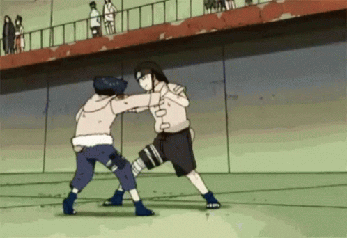

# ▸ Examen Chûnin



<mark style="color:$success;"><strong>»</strong></mark> <strong>DÉROULEMENT</strong> <mark style="color:$success;"><strong>«</strong></mark>

➜ <mark style="color:$success;">**Déclenchement**</mark>

> **20 %** de chances par partie, entre **60** et **80 minutes** de jeu.
>
> L'examen est annoncé **1 minute** avant. Il n'y a **pas d'inscription** : tous les ninjas en vie participent.

➜ <mark style="color:$success;">**Participants**</mark>

> Tournoi **individuel** : tous les combats se jouent en **1 contre 1**, en même temps, dans des **arènes séparées**.
>
> Avec un nombre impair de joueurs, un joueur tiré au sort attend dans les gradins, puis affronte le vainqueur du premier combat.

➜ <mark style="color:$success;">**Équipement**</mark>

> Un kit **incassable** :
>
> * casque, plastron et bottes en diamant **Protection II**, jambières en fer **Protection II** ;
> * épée en diamant **Tranchant III**, arc **Puissance II**, **16 flèches** ;
> * **3 pommes d'or**, **32 planches**, un seau de lave et un seau d'eau.

➜ <mark style="color:$success;">**Restrictions**</mark>

> * Pouvoirs, passifs, effets de rôle et natures sont **coupés**.
> * Chaque joueur a **10**<mark style="color:red;">**❤**</mark>, sans régénération naturelle.
> * Le **temps de la partie est en pause** (Bijû, largages, Jûbi, événements). Les cooldowns reprennent ensuite où ils en étaient.

➜ <mark style="color:$success;">**Combats**</mark>

> Chaque duel commence par un **compte à rebours de 5 secondes**, pendant lequel les combattants sont protégés.
>
> Le vainqueur passe à la manche suivante, jusqu'à la finale.

➜ <mark style="color:$success;">**Élimination**</mark>

> Le perdant n'est **pas tué** : il devient **spectateur**, volant et invisible, jusqu'à la fin de l'examen.
>
> Sa **boussole** permet de rejoindre un combattant, et deux objets passent au combattant précédent ou suivant.

➜ <mark style="color:$success;">**Fin**</mark>

> Quand il ne reste qu'un vainqueur, chaque joueur retrouve sa **position**, son **inventaire**, sa **vie** et ses **effets** d'avant l'examen.





<mark style="color:$success;"><strong>»</strong></mark> <strong>RÉCOMPENSES</strong> <mark style="color:$success;"><strong>«</strong></mark>

**Vainqueur**

* **16 pommes d'or**.
* Cooldowns de ses pouvoirs réduits de **20 %**.
* **+10 %** d'un effet qu'il n'a pas (<mark style="color:red;">**Force**</mark>, <mark style="color:blue;">**Résistance**</mark> ou <mark style="color:cyan;">**Vitesse**</mark>) jusqu'à la fin de la partie.

**2ᵉ place**

* **8 pommes d'or**.

**Demi-finalistes**

* **4 pommes d'or**.



***

<figure><figcaption>
Examen Chûnin.
</figcaption></figure>

