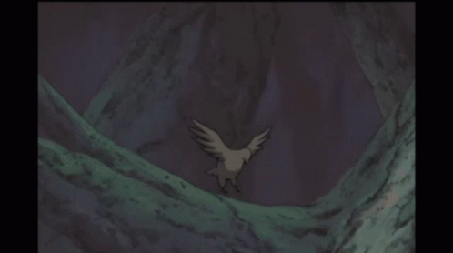

# ▸ Forêt de la Mort



<mark style="color:$success;"><strong>»</strong></mark> <strong>DÉROULEMENT</strong> <mark style="color:$success;"><strong>«</strong></mark>

➜ <mark style="color:$success;">**Inscription**</mark> • `/ns foret rejoindre`

> **15 %** de chances par partie, entre **40** et **60 minutes** de jeu.
>
> Les inscriptions durent **1 minute** : cliquez sur le bouton **REJOINDRE LA FORÊT DE LA MORT** du chat.
>
> <mark style="color:red;">⚠ Seuls les joueurs </mark><mark style="color:red;">**en vie**</mark><mark style="color:red;"> et </mark><mark style="color:red;">**hors combat**</mark><mark style="color:red;"> peuvent s'inscrire. Sans </mark><mark style="color:red;">**20 inscrits**</mark><mark style="color:red;">, l'épreuve est annulée.</mark>

➜ <mark style="color:$success;">**Équipes**</mark>

> **20 joueurs**, répartis au hasard en **4 équipes de 5** : <mark style="color:blue;">**Bleue**</mark>, <mark style="color:red;">**Rouge**</mark>, <mark style="color:orange;">**Orange**</mark> et <mark style="color:violet;">**Mauve**</mark>.
>
> Chaque équipe démarre dans sa **base**, avec son **parchemin**.

➜ <mark style="color:$success;">**Équipement**</mark>

> * Armure en cuir **incassable** aux couleurs de l'équipe : **Protection III** (jambières **Protection II**).
> * Épée en diamant **Tranchant III**, arc **Puissance II**, **16 flèches**.
> * Pioche et hache en fer incassables.
> * **3 pommes d'or**, **16 planches**, un seau de lave et un seau d'eau.

➜ <mark style="color:$success;">**Restrictions**</mark>

> * Pouvoirs, passifs, effets de rôle et natures sont **coupés**.
> * Chaque joueur a **10**<mark style="color:red;">**❤**</mark>, sans régénération naturelle.
> * Impossible de construire dans le carré d'apparition d'une base.

➜ <mark style="color:$success;">**Objectif**</mark> • `Clic-Droit` sur un parchemin

> * Volez le parchemin d'une **autre équipe**, puis rapportez-le dans **votre base** : cette équipe est **éliminée**.
> * Le voleur apparaît en surbrillance **5 secondes** après le vol.
>
> <mark style="color:red;">⚠ Un joueur ne porte qu'</mark><mark style="color:red;">**un parchemin**</mark><mark style="color:red;"> à la fois. Un parchemin est protégé tant qu'un membre de son équipe porte déjà un parchemin.</mark>

➜ <mark style="color:$success;">**Caisses**</mark>

> Une caisse apparaît au centre toutes les **10 secondes**. Elle donne au hasard :
>
> * **Répulsion** : `Clic-Droit` en visant un joueur, il est projeté de **20 blocs** ;
> * **Cocon de bois** : `Clic-Droit` en visant un joueur, il est enfermé **2 secondes** ;
> * **Dash** : `Clic-Droit`, bond de **15 blocs** devant soi ;
> * **64 pierres**, **16 pierres de l'End** ou **16 flèches**.
>
> Les trois objets spéciaux sont à **usage unique**.

➜ <mark style="color:$success;">**Mort**</mark>

> Un joueur tué reste **5 secondes** en spectateur, puis réapparaît dans sa base avec son kit.
>
> Le parchemin qu'il portait **retourne** dans sa base.

➜ <mark style="color:$success;">**Fin**</mark>

> L'épreuve se termine quand il ne reste **qu'une équipe**. Chaque joueur retrouve sa **position**, son **inventaire**, sa **vie** et ses **effets** d'avant l'événement.





<mark style="color:$success;"><strong>»</strong></mark> <strong>RÉCOMPENSES</strong> <mark style="color:$success;"><strong>«</strong></mark>

**Équipe gagnante**

Chaque joueur reçoit **une récompense au hasard**, indépendamment de ses coéquipiers :

* un **Renseignement Bijû** : il choisit un Bijû qu'il ne possède pas et obtient ses coordonnées, ou celles de son hôte ;
* **16 pommes d'or** ;
* **+10 %** d'un effet qu'il n'a pas (<mark style="color:red;">**Force**</mark>, <mark style="color:blue;">**Résistance**</mark> ou <mark style="color:cyan;">**Vitesse**</mark>) jusqu'à la fin de la partie ;
* **25 %** de chances que ses pommes d'or donnent **1**<mark style="color:red;">**❤**</mark> d'<mark style="color:yellow;">absorption</mark> en plus ;
* cooldowns de ses pouvoirs réduits de **20 %**.

**2ᵉ place**

* **8 pommes d'or** par joueur.

**3ᵉ place**

* **6 pommes d'or** par joueur.

**4ᵉ place**

* **4 pommes d'or** par joueur.



***

<figure><figcaption>
La Forêt de la Mort.
</figcaption></figure>

