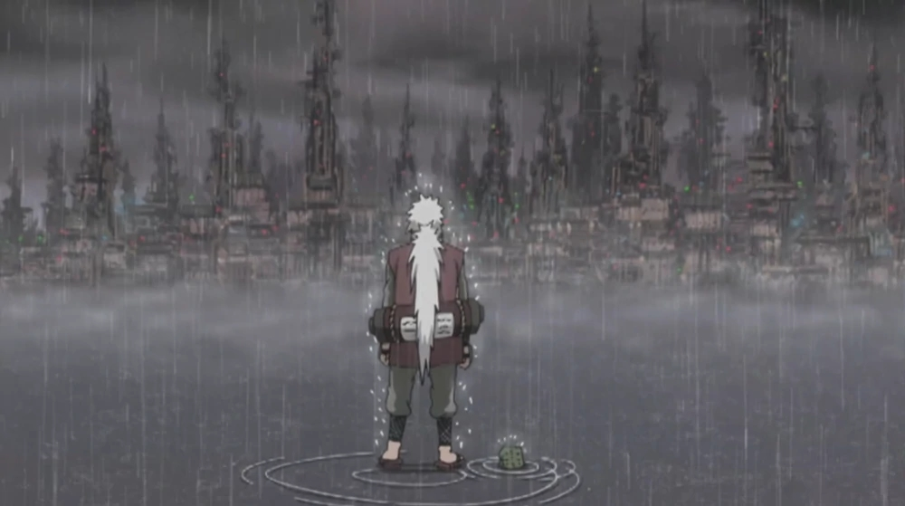

# ▸ Pluie de Kiri



<mark style="color:$success;"><strong>»</strong></mark> <strong>DÉROULEMENT</strong> <mark style="color:$success;"><strong>«</strong></mark>

➜ <mark style="color:$success;">**Déclenchement**</mark>

> **10 %** de chances par partie, entre **60** et **80 minutes** de jeu. L'événement est annoncé à tous les joueurs.

➜ <mark style="color:$success;">**Pendant la pluie**</mark>

> Pendant **5 minutes**, une pluie d'orage s'abat sur la carte : des gouttes éclaboussent le sol autour de chaque joueur.
>
> * **Plus personne ne voit le pseudo des autres joueurs.**
> * Pouvoirs, passifs et natures restent actifs.

➜ <mark style="color:$success;">**Fin**</mark>

> Au bout de **5 minutes**, la pluie s'arrête et les pseudos redeviennent visibles.



***

<figure><figcaption>
Le village caché de la Pluie.
</figcaption></figure>

