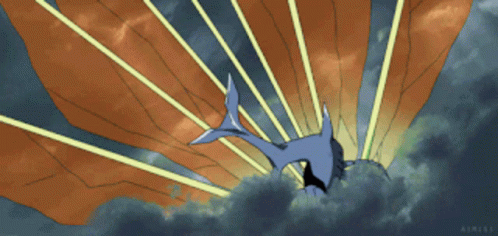

# ▸ Chômei — Sept queues



<mark style="color:$success;"><strong>»</strong></mark> <strong>CRÉATURE</strong> <mark style="color:$success;"><strong>«</strong></mark>

➜ <mark style="color:$success;">**Chômei**</mark> • **100**<mark style="color:red;">**❤**</mark> • <mark style="color:red;">**Force I**</mark>

> <mark style="color:yellow;">**Chômei**</mark> est un **Ghast** entouré de particules vertes et jaunes, avec **100**<mark style="color:red;">**❤**</mark> et <mark style="color:red;">**Force I**</mark>.
>
> Il vole autour des joueurs et leur lance des boules de feu qui ne cassent aucun bloc et n'enflamment rien : chaque boule a **15 %** de chances de donner <mark style="color:purple;">**Lenteur I**</mark> pendant **3 secondes**.
>
> Il ne se régénère pas et ne casse aucun bloc.
>
> Le joueur qui l'achève la récupère.





<mark style="color:$success;"><strong>»</strong></mark> <strong>POUVOIR DE L'HÔTE</strong> <mark style="color:$success;"><strong>«</strong></mark>

➜ <mark style="color:$success;">**Pouvoir de Chômei**</mark> • `Clic-Droit` avec l'objet du Bijû • ⏳ : 1 minute • ⌚ : 15 minutes

> Pendant **1 minute**, l'hôte obtient <mark style="color:cyan;">**Vitesse I**</mark>, ne subit aucun dégât de chute, et peut faire un dash de **15 blocs** devant lui avec un double saut, toutes les **10 secondes**, même en l'air.
>
> Des ailes vertes et jaunes apparaissent dans son dos.
>
> ⚠ Le dash ne traverse pas les blocs.



***

<figure><figcaption>
Illustration de Chômei.
</figcaption></figure>

