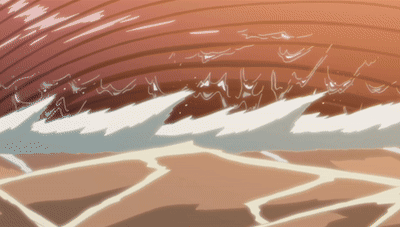

# ▸ Isobu — Trois queues



<mark style="color:$success;"><strong>»</strong></mark> <strong>CRÉATURE</strong> <mark style="color:$success;"><strong>«</strong></mark>

➜ <mark style="color:$success;">**Isobu**</mark> • **100**<mark style="color:red;">**❤**</mark> • <mark style="color:red;">**Force I**</mark>

> <mark style="color:blue;">**Isobu**</mark> est un **grand gardien** avec **100**<mark style="color:red;">**❤**</mark> et <mark style="color:red;">**Force I**</mark>.
>
> Chaque coup qu'on lui porte a **15 %** de chances de renvoyer des dégâts, comme l'enchantement Épines.
>
> Le joueur qui l'achève la récupère.





<mark style="color:$success;"><strong>»</strong></mark> <strong>POUVOIR DE L'HÔTE</strong> <mark style="color:$success;"><strong>«</strong></mark>

➜ <mark style="color:$success;">**Pouvoir de Isobu**</mark> • `Clic-Droit` avec l'objet du Bijû • ⏳ : 1 minute • ⌚ : 15 minutes

> Pendant **1 minute**, l'hôte obtient <mark style="color:blue;">**Résistance I**</mark>, **Épines I** sur toute son armure et **Depth Strider II** sur ses bottes.



***

<figure><figcaption>
Illustration de Isobu.
</figcaption></figure>

