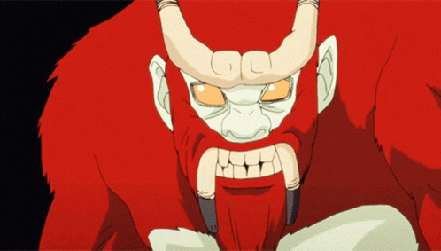

# ▸ Son Gokû — Quatre queues



<mark style="color:$success;"><strong>»</strong></mark> <strong>CRÉATURE</strong> <mark style="color:$success;"><strong>«</strong></mark>

➜ <mark style="color:$success;">**Son Gokû**</mark> • **100**<mark style="color:red;">**❤**</mark> • <mark style="color:red;">**Force I**</mark>

> <mark style="color:red;">**Son Gokû**</mark> est un **Blaze** entouré de lave, avec **100**<mark style="color:red;">**❤**</mark> et <mark style="color:red;">**Force I**</mark>.
>
> Chacun de ses coups a **15 %** de chances d'enflammer pendant **3 secondes**. Il ne craint ni le feu ni la lave.
>
> Le joueur qui l'achève la récupère.





<mark style="color:$success;"><strong>»</strong></mark> <strong>POUVOIR DE L'HÔTE</strong> <mark style="color:$success;"><strong>«</strong></mark>

➜ <mark style="color:$success;">**Pouvoir de Son Gokû**</mark> • `Clic-Droit` avec l'objet du Bijû • ⏳ : 1 minute • ⌚ : 15 minutes

> Pendant **1 minute**, l'hôte obtient <mark style="color:orange;">**Résistance au feu**</mark>, et ses coups d'épée ont **15 %** de chances d'enflammer pendant **3 secondes**.



***

<figure><figcaption>
Illustration de Son Gokû.
</figcaption></figure>

