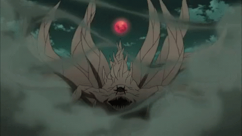

# ▸ Jûbi

> **Jûbi** peut être obtenu de **deux façons différentes**, qui n'ont pas les mêmes conséquences.
>
> * Le **Réveil** est un objectif **collectif** de l'Akatsuki : il renforce tout le camp et déclenche un **cataclysme**.
> * Le **rituel des Six Chemins** est **personnel** : un seul joueur devient le **Jinchûriki** de Jûbi.

<table data-view="cards"><thead><tr><th align="center"></th><th data-hidden data-card-target data-type="content-ref"></th></tr></thead><tbody><tr><td align="center"><mark style="color:red;"><strong>Le Réveil de Jûbi</strong></mark> Akatsuki</td><td><a href="reveil-de-jubi.md">reveil-de-jubi.md</a></td></tr><tr><td align="center"><mark style="color:orange;"><strong>Jinchûriki des Six Chemins</strong></mark> Rituel personnel</td><td><a href="jinchuriki-des-six-chemins.md">jinchuriki-des-six-chemins.md</a></td></tr></tbody></table>


Jûbi est un réglage de l'**host** : il n'est disponible que s'il a été **activé** pour la partie.


***

<figure><figcaption>
Illustration de Jûbi.
</figcaption></figure>

