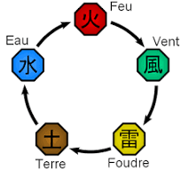

# ▸ Natures de chakra

<h3 align="center"><mark style="color:$success;"><strong>»</strong></mark> Présentation <mark style="color:$success;"><strong>«</strong></mark></h3>

> Chaque rôle possède une ou plusieurs **natures de chakra**. Chacune donne un **passif** permanent.
>
> Certains rôles ont une **nature aléatoire**, tirée au début de la partie puis conservée.
>
> `/ns natures` affiche les natures et leurs rôles en jeu.


Un rôle avec plusieurs natures cumule leurs passifs. Les passifs de natures sont **coupés** pendant l'Examen Chûnin et la Forêt de la Mort.


<h3 align="center"><mark style="color:$success;"><strong>»</strong></mark> Natures <mark style="color:$success;"><strong>«</strong></mark></h3>



➜ <mark style="color:red;">**Katon**</mark> • Feu • `Passif`

> Coups d'épée : **2 %** de chances d'enflammer pendant **3 secondes**.
>
> Rôles : [<mark style="color:green;">**Jiraya**</mark>](../roles/shinobi/jiraya.md), [<mark style="color:green;">**Mei**</mark>](../roles/shinobi/mei.md), [<mark style="color:red;">**Nagato**</mark>](../roles/akatsuki/nagato.md), [<mark style="color:red;">**Itachi**</mark>](../roles/akatsuki/itachi.md), [<mark style="color:red;">**Obito**</mark>](../roles/akatsuki/obito.md), [<mark style="color:orange;">**Madara**</mark>](../roles/solos/madara.md), [<mark style="color:orange;">**Sasuke**</mark>](../roles/solos/sasuke.md), [<mark style="color:orange;">**Kaguya**</mark>](../roles/solos/kaguya.md).





➜ <mark style="color:blue;">**Suiton**</mark> • Eau • `Passif`

> **Depth Strider I** dans l'eau.
>
> Rôles : [<mark style="color:green;">**Kakashi**</mark>](../roles/shinobi/kakashi.md), [<mark style="color:green;">**Mei**</mark>](../roles/shinobi/mei.md), [<mark style="color:red;">**Nagato**</mark>](../roles/akatsuki/nagato.md), [<mark style="color:red;">**Itachi**</mark>](../roles/akatsuki/itachi.md), [<mark style="color:red;">**Kisame**</mark>](../roles/akatsuki/kisame.md), [<mark style="color:red;">**Jûzô**</mark>](../roles/akatsuki/juzo.md), [<mark style="color:blue;">**Kabuto**</mark>](../roles/reincarnes/kabuto.md), [<mark style="color:blue;">**Haku**</mark>](../roles/reincarnes/haku.md), [<mark style="color:blue;">**Zabuza**</mark>](../roles/reincarnes/zabuza.md), [<mark style="color:orange;">**Madara**</mark>](../roles/solos/madara.md), [<mark style="color:orange;">**Kaguya**</mark>](../roles/solos/kaguya.md).





➜ <mark style="color:yellow;">**Raiton**</mark> • Foudre • `Passif`

> Coups d'épée : **2 %** de chances d'infliger <mark style="color:purple;">**Lenteur II**</mark> pendant **2 secondes**.
>
> Rôles : [<mark style="color:green;">**Kakashi**</mark>](../roles/shinobi/kakashi.md), [<mark style="color:green;">**Killer Bee**</mark>](../roles/shinobi/killerbee.md), [<mark style="color:green;">**Quatrième Raikage**</mark>](../roles/shinobi/raikage.md), [<mark style="color:red;">**Nagato**</mark>](../roles/akatsuki/nagato.md), [<mark style="color:red;">**Deidara**</mark>](../roles/akatsuki/deidara.md), [<mark style="color:blue;">**Troisième Raikage**</mark>](../roles/reincarnes/raikage3.md), [<mark style="color:orange;">**Madara**</mark>](../roles/solos/madara.md), [<mark style="color:orange;">**Sasuke**</mark>](../roles/solos/sasuke.md), [<mark style="color:orange;">**Kaguya**</mark>](../roles/solos/kaguya.md).





➜ <mark style="color:green;">**Fûton**</mark> • Vent • `Passif`

> Coups d'épée : **2 %** de chances d'ajouter **3 blocs** de recul.
>
> Rôles : [<mark style="color:green;">**Naruto**</mark>](../roles/shinobi/naruto.md), [<mark style="color:green;">**Gaara**</mark>](../roles/shinobi/gaara.md), [<mark style="color:green;">**Minato**</mark>](../roles/shinobi/minato.md), [<mark style="color:green;">**Ônoki**</mark>](../roles/shinobi/onoki.md), [<mark style="color:red;">**Nagato**</mark>](../roles/akatsuki/nagato.md), [<mark style="color:red;">**Konan**</mark>](../roles/akatsuki/konan.md), [<mark style="color:blue;">**Mû**</mark>](../roles/reincarnes/mu.md), [<mark style="color:orange;">**Madara**</mark>](../roles/solos/madara.md), [<mark style="color:orange;">**Kaguya**</mark>](../roles/solos/kaguya.md).





➜ <mark style="color:orange;">**Doton**</mark> • Terre • `Passif`

> **50 %** de dégâts de chute en moins.
>
> Rôles : [<mark style="color:green;">**Chôji**</mark>](../roles/shinobi/choji.md), [<mark style="color:green;">**Kiba**</mark>](../roles/shinobi/kiba.md), [<mark style="color:green;">**Gaara**</mark>](../roles/shinobi/gaara.md), [<mark style="color:green;">**Jiraya**</mark>](../roles/shinobi/jiraya.md), [<mark style="color:green;">**Tsunade**</mark>](../roles/shinobi/tsunade.md), [<mark style="color:green;">**Ônoki**</mark>](../roles/shinobi/onoki.md), [<mark style="color:red;">**Nagato**</mark>](../roles/akatsuki/nagato.md), [<mark style="color:red;">**Deidara**</mark>](../roles/akatsuki/deidara.md), [<mark style="color:red;">**Sasori**</mark>](../roles/akatsuki/sasori.md), [<mark style="color:red;">**Kakuzu**</mark>](../roles/akatsuki/kakuzu.md), [<mark style="color:red;">**Obito**</mark>](../roles/akatsuki/obito.md), [<mark style="color:red;">**Zetsu**</mark>](../roles/akatsuki/zetsu.md), [<mark style="color:blue;">**Kabuto**</mark>](../roles/reincarnes/kabuto.md), [<mark style="color:blue;">**Mû**</mark>](../roles/reincarnes/mu.md), [<mark style="color:orange;">**Madara**</mark>](../roles/solos/madara.md), [<mark style="color:orange;">**Kaguya**</mark>](../roles/solos/kaguya.md).





➜ <mark style="color:$success;">**Nature aléatoire**</mark> • `Passif`

> Ces rôles tirent **une nature au hasard** en début de partie : [<mark style="color:green;">**Sakura**</mark>](../roles/shinobi/sakura.md), [<mark style="color:green;">**Hinata**</mark>](../roles/shinobi/hinata.md), [<mark style="color:green;">**Shikamaru**</mark>](../roles/shinobi/shikamaru.md), [<mark style="color:green;">**Rock Lee**</mark>](../roles/shinobi/rocklee.md), [<mark style="color:green;">**Gaï**</mark>](../roles/shinobi/gai.md), [<mark style="color:green;">**Hiruzen**</mark>](../roles/shinobi/hiruzen.md), [<mark style="color:red;">**Hidan**</mark>](../roles/akatsuki/hidan.md).



***

<figure><figcaption>
Les cinq natures de chakra.
</figcaption></figure>

