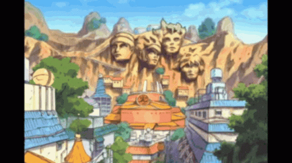

# ▸ Système de Hokage

<h3 align="center"><mark style="color:$success;"><strong>»</strong></mark> Présentation <mark style="color:$success;">«</mark></h3>

> À **50 minutes** de jeu, un joueur est désigné <mark style="color:orange;">**Hokage**</mark>.
>
> Son pseudo est annoncé à **tous les joueurs**. À sa mort, un successeur est désigné.



<mark style="color:$success;"><strong>»</strong></mark> <strong>DÉSIGNATION</strong> <mark style="color:$success;"><strong>«</strong></mark>

➜ <mark style="color:$success;">**Joueurs éligibles**</mark> • `Particularités`

> * Tous les joueurs en vie du camp des <mark style="color:green;">**Shinobi**</mark>.
> * [<mark style="color:orange;">**Sasuke**</mark>](../roles/solos/sasuke.md) et [<mark style="color:red;">**Itachi**</mark>](../roles/akatsuki/itachi.md).

➜ <mark style="color:$success;">**Premier Hokage**</mark> • `Particularités`

> À **50 minutes**, le premier <mark style="color:orange;">**Hokage**</mark> est tiré **au hasard** parmi les joueurs éligibles en vie.




<mark style="color:$success;"><strong>»</strong></mark> <strong>BONUS ET PROTECTION</strong> <mark style="color:$success;"><strong>«</strong></mark>

➜ <mark style="color:$success;">**Bonus du Hokage**</mark> • `Passif`

> * **3 pommes d'or**.
> * **+5 %** d'un effet qu'il n'a pas encore : <mark style="color:red;">**Force**</mark>, <mark style="color:blue;">**Résistance**</mark> ou <mark style="color:cyan;">**Vitesse**</mark>.

➜ <mark style="color:$success;">**Protecteurs**</mark> • `Particularités`

> **Deux joueurs éligibles**, tirés au hasard, sont prévenus qu'ils font partie de la **protection du Hokage**.




<mark style="color:$success;"><strong>»</strong></mark> <strong>SUCCESSION</strong> <mark style="color:$success;"><strong>«</strong></mark>

➜ <mark style="color:$success;">**Mort du Hokage**</mark> • `Particularités`

> **5 minutes** après la mort du <mark style="color:orange;">**Hokage**</mark>, le titre revient au joueur éligible encore en vie qui a infligé **le plus de dégâts** depuis le début de la partie.
>
> * Les dégâts de [<mark style="color:orange;">**Sasuke**</mark>](../roles/solos/sasuke.md) et d'[<mark style="color:red;">**Itachi**</mark>](../roles/akatsuki/itachi.md) ne comptent qu'à **75 %**.
> * Le nouveau <mark style="color:orange;">**Hokage**</mark> reçoit les mêmes bonus, et deux nouveaux protecteurs sont prévenus.


***

<figure><figcaption>
Le mont des Hokage.
</figcaption></figure>

