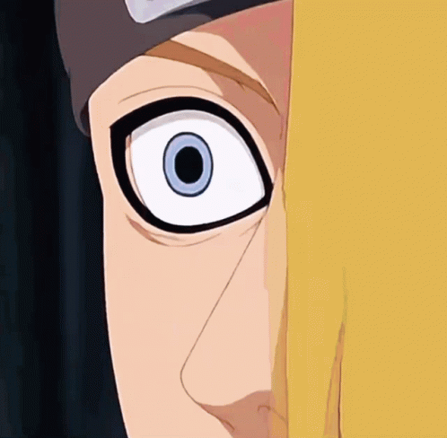

# ▸ Deidara



<mark style="color:$success;"><strong>»</strong></mark> <strong>IDENTITÉ</strong> <mark style="color:$success;"><strong>«</strong></mark>

➜ <mark style="color:$success;">**Camp**</mark> • <mark style="color:red;">**Akatsuki**</mark>

> Objectif : gagner avec l'<mark style="color:red;">**Akatsuki**</mark>.

➜ <mark style="color:$success;">**Chakra**</mark> • `Nature`

> <mark style="color:orange;">**Doton**</mark> et <mark style="color:yellow;">**Raiton**</mark> (voir [Natures de chakra](../../particularites/natures-de-chakra.md)).





<mark style="color:$success;"><strong>»</strong></mark> <strong>COMPÉTENCES</strong> <mark style="color:$success;"><strong>«</strong></mark>

➜ <mark style="color:$success;">**Connaissances**</mark> • `Particularités`

> <mark style="color:red;">**Deidara**</mark> ne connaît personne au départ. Il doit être reconnu par un membre du réseau de l'Akatsuki, puis il reconnaît les autres à son tour.
>
> Voir [Liste de l'Akatsuki](../../particularites/liste-de-lakatsuki.md).

➜ <mark style="color:$success;">**Bakuton**</mark> • `Passif`

> Chaque coup de <mark style="color:red;">**Deidara**</mark> a **5 %** de chances d'exploser : le joueur frappé subit **1**<mark style="color:red;">**❤**</mark> et il est projeté à **10 blocs**.





<mark style="color:$success;"><strong>»</strong></mark> <strong>CAPACITÉS</strong> <mark style="color:$success;"><strong>«</strong></mark>

➜ <mark style="color:$success;">**Étoile « Explosion »**</mark> • `Clic-Gauche` / `Clic-Droit`

> Ces pouvoirs sont réunis sur une Nether Star : **C1**, **C2**, **C3**, **C4**, **C0**.
>
> * `Clic-Gauche` : passer au pouvoir suivant.
> * `Clic-Droit` : utiliser le pouvoir sélectionné.

➜ <mark style="color:$success;">**C1**</mark> • `Clic-Droit` • Étoile « Explosion » • ⌚ : 3 minutes

> <mark style="color:red;">**Deidara**</mark> envoie un silverfish d'argile sur le joueur visé. Il ne mord pas : il explose à son contact et inflige **1**<mark style="color:red;">**❤**</mark>.

➜ <mark style="color:$success;">**C2**</mark> • `Clic-Droit` • Étoile « Explosion » • ⌚ : 10 minutes

> <mark style="color:red;">**Deidara**</mark> monte sur un loup blanc volant, jusqu'à **10 blocs** de haut, pendant **1 minute** au plus.
>
> Réutiliser le pouvoir lâche une TNT (**3** au total, une toutes les **3 secondes**). Elle explose au sol et inflige **1,5**<mark style="color:red;">**❤**</mark>.
>
> <mark style="color:red;">⚠ Sur le loup, </mark><mark style="color:red;">**Deidara**</mark><mark style="color:red;"> ne peut pas utiliser ses autres pouvoirs. Une flèche reçue fait disparaître le loup, qui disparaît aussi </mark><mark style="color:red;">**5 secondes**</mark><mark style="color:red;"> après la dernière TNT.</mark>

➜ <mark style="color:$success;">**C3**</mark> • `Clic-Droit` • Étoile « Explosion » • ⌚ : 8 minutes

> Un clone de <mark style="color:red;">**Deidara**</mark> court vers le joueur le plus proche et explose : ce joueur subit **1,5**<mark style="color:red;">**❤**</mark> et il est projeté à **10 blocs**.

➜ <mark style="color:$success;">**C4**</mark> • `Clic-Droit` • Étoile « Explosion » • ⌚ : 15 minutes

> <mark style="color:red;">**Deidara**</mark> invoque un zombie géant qui explose **7 secondes** plus tard. L'explosion creuse un trou de **40 blocs** de diamètre et inflige **4**<mark style="color:red;">**❤**</mark>.
>
> <mark style="color:red;">⚠ </mark><mark style="color:red;">**Deidara**</mark><mark style="color:red;"> peut être touché lui aussi.</mark>

➜ <mark style="color:$success;">**C0**</mark> • `Clic-Droit` • Étoile « Explosion »

> <mark style="color:red;">**Deidara**</mark> reste immobile et intouchable pendant **10 secondes**, puis explose dans une sphère de **50 blocs** de diamètre.
>
> <mark style="color:red;">⚠ Tous les joueurs dans la sphère meurent, </mark><mark style="color:red;">**Deidara**</mark><mark style="color:red;"> compris.</mark>



***

<figure><figcaption>
Illustration de Deidara.
</figcaption></figure>

