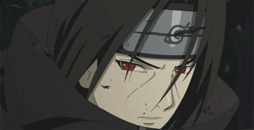

# ▸ Itachi



<mark style="color:$success;"><strong>»</strong></mark> <strong>IDENTITÉ</strong> <mark style="color:$success;"><strong>«</strong></mark>

➜ <mark style="color:$success;">**Camp**</mark> • <mark style="color:red;">**Akatsuki**</mark>

> Objectif : gagner avec l'<mark style="color:red;">**Akatsuki**</mark>.

➜ <mark style="color:$success;">**Chakra**</mark> • `Nature`

> <mark style="color:red;">**Katon**</mark> et <mark style="color:blue;">**Suiton**</mark> (voir [Natures de chakra](../../particularites/natures-de-chakra.md)).





<mark style="color:$success;"><strong>»</strong></mark> <strong>COMPÉTENCES</strong> <mark style="color:$success;"><strong>«</strong></mark>

➜ <mark style="color:$success;">**Connaissances**</mark> • `Particularités`

> <mark style="color:red;">**Itachi**</mark> ne connaît personne au départ. Il doit être reconnu par un membre du réseau de l'Akatsuki, puis il reconnaît les autres à son tour.
>
> Voir [Liste de l'Akatsuki](../../particularites/liste-de-lakatsuki.md).

➜ <mark style="color:$success;">**Sharingan**</mark> • `Passif`

> Contre un même joueur, <mark style="color:red;">**Itachi**</mark> esquive **5 %** de ses coups après **30 secondes** de combat, puis **10 %** après **1 minute**.





<mark style="color:$success;"><strong>»</strong></mark> <strong>CAPACITÉS</strong> <mark style="color:$success;"><strong>«</strong></mark>

➜ <mark style="color:$success;">**Tsukuyomi**</mark> • `Clic-Droit` • ⌚ : 10 minutes

> <mark style="color:red;">**Itachi**</mark> plonge le joueur visé dans une illusion pendant **2 minutes**, sans qu'il le remarque :
>
> * À partir de **30 secondes**, il subit de faux dégâts de **½**<mark style="color:red;">**❤**</mark> toutes les **5 secondes**.
> * À **45 secondes**, il subit <mark style="color:violet;">**Cécité**</mark> pendant **3 secondes**.
> * À partir de **1 minute**, il subit <mark style="color:purple;">**Lenteur I**</mark> pendant **2 secondes** toutes les **15 secondes**.

➜ <mark style="color:$success;">**Amaterasu**</mark> • `Clic-Droit` • ⌚ : 10 minutes

> Le joueur visé brûle pendant **10 secondes**, sans pouvoir s'éteindre.
>
> ⚠ Ensuite, <mark style="color:red;">**Itachi**</mark> subit <mark style="color:violet;">**Cécité**</mark> pendant **5 secondes**.

➜ <mark style="color:$success;">**Utakata**</mark> • `Clic-Droit` • ⌚ : 10 minutes

> Pendant **1 minute**, le joueur visé subit une illusion toutes les **10 secondes** :
>
> * **Cinq clones** d'<mark style="color:red;">**Itachi**</mark> apparaissent autour de lui pendant **5 secondes**. Lui seul les voit.
> * Il croit subir **5**<mark style="color:red;">**❤**</mark> de dégâts.
> * Il voit le corps d'<mark style="color:red;">**Itachi**</mark> s'effondrer, et <mark style="color:red;">**Itachi**</mark> lui est invisible pendant **2 secondes**.
> * Il voit l'écran de mort pendant **3 secondes**.

➜ <mark style="color:$success;">**Susano**</mark> • `Clic-Droit` • ⏳ : 2 minutes • ⌚ : 10 minutes

> <mark style="color:red;">**Itachi**</mark> obtient <mark style="color:blue;">**Résistance I**</mark>, et son épée passe en **Tranchant IV**. Parer repousse l'adversaire de **5 blocs**.
>
> Chacun de ses coups a **5 %** de chances de faire sortir le joueur frappé de son corps pendant **1 seconde**.
>
> Son corps reste sur place et peut être frappé : à son retour, le joueur subit les coups reçus par son corps.



***

<figure><figcaption>
Illustration de Itachi.
</figcaption></figure>

