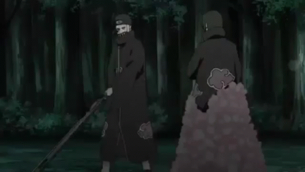

# ▸ Jûzô



<mark style="color:$success;"><strong>»</strong></mark> <strong>IDENTITÉ</strong> <mark style="color:$success;"><strong>«</strong></mark>

➜ <mark style="color:$success;">**Camp**</mark> • <mark style="color:red;">**Akatsuki**</mark>

> Objectif : gagner avec l'<mark style="color:red;">**Akatsuki**</mark>.

➜ <mark style="color:$success;">**Chakra**</mark> • `Nature`

> <mark style="color:blue;">**Suiton**</mark> (voir [Natures de chakra](../../particularites/natures-de-chakra.md)).





<mark style="color:$success;"><strong>»</strong></mark> <strong>COMPÉTENCES</strong> <mark style="color:$success;"><strong>«</strong></mark>

➜ <mark style="color:$success;">**Connaissances**</mark> • `Particularités`

> <mark style="color:red;">**Jûzô**</mark> ne connaît personne au départ. Il doit être reconnu par un membre du réseau de l'Akatsuki, puis il reconnaît les autres à son tour.
>
> Voir [Liste de l'Akatsuki](../../particularites/liste-de-lakatsuki.md).

➜ <mark style="color:$success;">**Kubikiribōchō**</mark> • `Passif`

> <mark style="color:red;">**Jûzô**</mark> possède une épée en diamant **Tranchant IV**. Tous les **15 coups**, il inflige un saignement : **½**<mark style="color:red;">**❤**</mark> toutes les **2 secondes** pendant **6 secondes**.





<mark style="color:$success;"><strong>»</strong></mark> <strong>CAPACITÉS</strong> <mark style="color:$success;"><strong>«</strong></mark>

➜ <mark style="color:$success;">**Étoile « Brume »**</mark> • `Clic-Gauche` / `Clic-Droit`

> Ces pouvoirs sont réunis sur une Nether Star : **Brume Sanglante**, **Lancer du Couperet**, **Clone Aqueux**, **Dernier Rempart**.
>
> * `Clic-Gauche` : passer au pouvoir suivant.
> * `Clic-Droit` : utiliser le pouvoir sélectionné.

➜ <mark style="color:$success;">**Brume Sanglante**</mark> • `Clic-Droit` • Étoile « Brume » • ⌚ : 8 minutes

> <mark style="color:red;">**Jûzô**</mark> crée une brume de **20 blocs** autour de lui pendant **30 secondes**.
>
> Les autres joueurs y subissent <mark style="color:violet;">**Cécité**</mark> et ne voient plus les pseudos au-delà de **5 blocs**.
>
> Dans la brume, ses coups dans le dos infligent **½**<mark style="color:red;">**❤**</mark> de plus, au plus toutes les **5 secondes**.

➜ <mark style="color:$success;">**Lancer du Couperet**</mark> • `Clic-Droit` • Étoile « Brume » • ⌚ : 3 minutes

> <mark style="color:red;">**Jûzô**</mark> lance son épée droit devant lui sur **20 blocs**. Le premier joueur touché subit **1,5**<mark style="color:red;">**❤**</mark> et recule de **5 blocs**, puis l'épée revient vers <mark style="color:red;">**Jûzô**</mark>.
>
> <mark style="color:red;">⚠ </mark><mark style="color:red;">**Jûzô**</mark><mark style="color:red;"> n'a plus son épée tant qu'elle n'est pas revenue dans sa main.</mark>

➜ <mark style="color:$success;">**Clone Aqueux**</mark> • `Clic-Droit` • Étoile « Brume » • ⏳ : 20 secondes • ⌚ : 5 minutes

> <mark style="color:red;">**Jûzô**</mark> invoque un clone de **6**<mark style="color:red;">**❤**</mark> pendant **20 secondes**, qui attaque le dernier joueur frappé. Réutiliser le pouvoir échange sa place avec le clone.
>
> Si le clone est tué, il éclate : <mark style="color:purple;">**Lenteur I**</mark> pendant **3 secondes** pour les joueurs à moins de **3 blocs**.

➜ <mark style="color:$success;">**Dernier Rempart**</mark> • `Clic-Droit` • Étoile « Brume » • ⌚ : 5 minutes

> <mark style="color:red;">**Jûzô**</mark> se téléporte sur le dernier joueur frappé dans les **30 dernières secondes**. Pendant **3 secondes**, le premier coup d'épée qu'il reçoit est bloqué, et l'attaquant recule de **5 blocs**.



***

<figure><figcaption>
Illustration de Jûzô.
</figcaption></figure>

