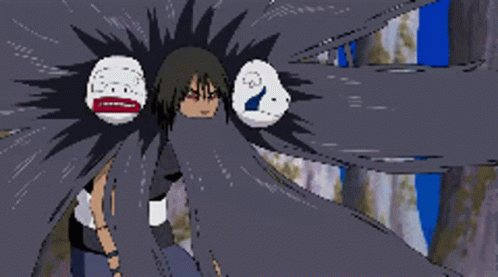

# ▸ Kakuzu



<mark style="color:$success;"><strong>»</strong></mark> <strong>IDENTITÉ</strong> <mark style="color:$success;"><strong>«</strong></mark>

➜ <mark style="color:$success;">**Camp**</mark> • <mark style="color:red;">**Akatsuki**</mark>

> Objectif : gagner avec l'<mark style="color:red;">**Akatsuki**</mark>.

➜ <mark style="color:$success;">**Chakra**</mark> • `Nature`

> <mark style="color:orange;">**Doton**</mark> au départ ; autres natures liées aux cœurs acquis (voir [Natures de chakra](../../particularites/natures-de-chakra.md)).





<mark style="color:$success;"><strong>»</strong></mark> <strong>COMPÉTENCES</strong> <mark style="color:$success;"><strong>«</strong></mark>

➜ <mark style="color:$success;">**Connaissances**</mark> • `Particularités`

> <mark style="color:red;">**Kakuzu**</mark> ne connaît personne au départ. Il doit être reconnu par un membre du réseau de l'Akatsuki, puis il reconnaît les autres à son tour.
>
> Voir [Liste de l'Akatsuki](../../particularites/liste-de-lakatsuki.md).

➜ <mark style="color:$success;">**Effet**</mark> • `Passif`

> <mark style="color:red;">**Kakuzu**</mark> possède **12**<mark style="color:red;">**❤**</mark>.

➜ <mark style="color:$success;">**Les Cinq Cœurs**</mark> • `/ns coeurs`

> <mark style="color:red;">**Kakuzu**</mark> commence avec un masque Doton. `Clic-Droit` sur le cadavre d'un joueur qu'il a tué : il gagne un masque d'une nature qu'il n'a pas encore, **5** au maximum.
>
> `/ns coeurs` affiche ses masques et leur vie.

➜ <mark style="color:$success;">**Derniers Fils**</mark> • `Passif`

> Quand un masque est détruit, ses fils repoussent de **3 blocs** les joueurs à moins de **3 blocs**.





<mark style="color:$success;"><strong>»</strong></mark> <strong>CAPACITÉS</strong> <mark style="color:$success;"><strong>«</strong></mark>

➜ <mark style="color:$success;">**Masques**</mark> • `/ns masque`

> `/ns masque` : <mark style="color:red;">**Kakuzu**</mark> sort ou range un masque. Un masque sorti flotte près de son épaule et attaque le dernier joueur frappé.
>
> * Chaque masque a **20**<mark style="color:red;">**❤**</mark>, sans armure. Rangé, il récupère tous ses cœurs.
> * **Deux masques** au plus peuvent être sortis en même temps.
> * Pour en ranger un, <mark style="color:red;">**Kakuzu**</mark> doit passer **10 secondes** sans frapper ni être frappé.
>
> <mark style="color:red;">⚠ Un masque détruit perd son cœur : </mark><mark style="color:red;">**Kakuzu**</mark><mark style="color:red;"> doit tuer un autre joueur pour en récupérer un.</mark>

➜ <mark style="color:$success;">**Techniques des masques**</mark> • `Clic-Droit` • ⌚ : 5 minutes

> Toutes les **15 secondes**, chaque masque sorti attaque et inflige **1**<mark style="color:red;">**❤**</mark>, avec un effet selon sa nature :
>
> * **Doton :** le projectile explose et repousse le joueur de **3 blocs**.
> * **Katon :** le joueur brûle pendant **3 secondes**.
> * **Fûton :** le joueur est soulevé de **3 blocs**, puis plaqué au sol.
> * **Raiton :** un éclair frappe le joueur et l'immobilise **0,2 seconde**.
> * **Suiton :** tant que ce masque est sorti, les bottes de <mark style="color:red;">**Kakuzu**</mark> ont **Depth Strider II**.

➜ <mark style="color:$success;">**Fils Noirs**</mark> • `Clic-Droit` • ⌚ : 5 minutes

> <mark style="color:red;">**Kakuzu**</mark> relie à lui un joueur à moins de **15 blocs** pendant **4 secondes** : le joueur ne peut pas s'éloigner à plus de **8 blocs**.
>
> Réutiliser le pouvoir le ramène vers <mark style="color:red;">**Kakuzu**</mark> et lui inflige **1,5**<mark style="color:red;">**❤**</mark>.

➜ <mark style="color:$success;">**Combinaison Élémentaire**</mark> • `Clic-Droit` • ⌚ : 10 minutes

> Avec les masques Katon et Fûton sortis, <mark style="color:red;">**Kakuzu**</mark> projette devant lui un souffle de feu de **20 × 5**. Les joueurs touchés subissent **2,5**<mark style="color:red;">**❤**</mark> et brûlent pendant **5 secondes**.



***

<figure><figcaption>
Illustration de Kakuzu.
</figcaption></figure>

