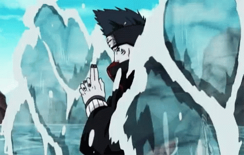

# ▸ Kisame



<mark style="color:$success;"><strong>»</strong></mark> <strong>IDENTITÉ</strong> <mark style="color:$success;"><strong>«</strong></mark>

➜ <mark style="color:$success;">**Camp**</mark> • <mark style="color:red;">**Akatsuki**</mark>

> Objectif : gagner avec l'<mark style="color:red;">**Akatsuki**</mark>.

➜ <mark style="color:$success;">**Chakra**</mark> • `Nature`

> <mark style="color:blue;">**Suiton**</mark> (voir [Natures de chakra](../../particularites/natures-de-chakra.md)).





<mark style="color:$success;"><strong>»</strong></mark> <strong>COMPÉTENCES</strong> <mark style="color:$success;"><strong>«</strong></mark>

➜ <mark style="color:$success;">**Connaissances**</mark> • `Particularités`

> <mark style="color:red;">**Kisame**</mark> ne connaît personne au départ. Il doit être reconnu par un membre du réseau de l'Akatsuki, puis il reconnaît les autres à son tour.
>
> Voir [Liste de l'Akatsuki](../../particularites/liste-de-lakatsuki.md).

➜ <mark style="color:$success;">**Effet**</mark> • `Passif`

> Les bottes de <mark style="color:red;">**Kisame**</mark> ont **Depth Strider III**.

➜ <mark style="color:$success;">**Samehada**</mark> • `Passif`

> <mark style="color:red;">**Kisame**</mark> possède une épée en diamant **Tranchant IV**. Chacun de ses coups a **10 %** de chances de lui rendre **½**<mark style="color:red;">**❤**</mark>, et **20 %** contre un porteur de Bijû.
>
> `/ns samehada` **active** ou **désactive** ce passif.

➜ <mark style="color:$success;">**Détection**</mark> • `Passif`

> Les joueurs proches qui utilisent un pouvoir [brillent en bleu](../../informations/lunar-client.md#surbrillance) pendant **30 secondes**.





<mark style="color:$success;"><strong>»</strong></mark> <strong>CAPACITÉS</strong> <mark style="color:$success;"><strong>«</strong></mark>

➜ <mark style="color:$success;">**Nether Star « Poissons »**</mark> • `Clic-Gauche` / `Clic-Droit`

> Ces pouvoirs sont réunis sur une Nether Star : **Forme Homme-Requin**, **Daikōdan no Jutsu**, **Senshokuzame**.
>
> * `Clic-Gauche` : passer au pouvoir suivant.
> * `Clic-Droit` : utiliser le pouvoir sélectionné.

➜ <mark style="color:$success;">**Forme Homme-Requin**</mark> • `Clic-Droit` • Nether Star « Poissons » • ⏳ : 30 secondes • ⌚ : 15 minutes

> <mark style="color:red;">**Kisame**</mark> s'entoure d'une sphère d'eau de **25 blocs** qui le suit pendant **30 secondes**. Le passif de Samehada passe à **15 %**, et à **30 %** contre un porteur de Bijû.
>
> <mark style="color:red;">⚠ Personne ne peut se noyer dans la sphère.</mark>

➜ <mark style="color:$success;">**Daikōdan no Jutsu**</mark> • `Clic-Droit` • Nether Star « Poissons » • ⌚ : 5 minutes

> <mark style="color:red;">**Kisame**</mark> lance une tête de requin vers le joueur visé, jusqu'à **30 blocs**. Si elle le touche, elle s'accroche à lui : il subit **2**<mark style="color:red;">**❤**</mark>, puis **½**<mark style="color:red;">**❤**</mark> toutes les **5 secondes**.
>
> Le joueur peut toujours bouger. Il se libère en frappant le requin, qui a **5**<mark style="color:red;">**❤**</mark>.

➜ <mark style="color:$success;">**Senshokuzame**</mark> • `Clic-Droit` • Nether Star « Poissons » • ⌚ : 10 minutes

> <mark style="color:red;">**Kisame**</mark> remplit d'eau un rectangle de **30 × 30** blocs devant lui, haut de **6 blocs**, pendant **30 secondes**.
>
> **12 requins** y nagent et attaquent les ennemis : chaque morsure inflige **1**<mark style="color:red;">**❤**</mark>, au plus toutes les **5 secondes** par requin.
>
> * Un requin a **1**<mark style="color:red;">**❤**</mark> : frappé, il meurt.
> * **2 requins** au plus attaquent le même joueur.
> * Les requins restent dans l'eau, et personne ne peut s'y noyer.
>
> Au bout de **30 secondes**, l'eau disparaît, et les blocs qu'elle avait remplacés restent cassés.



***

<figure><figcaption>
Illustration de Kisame.
</figcaption></figure>

