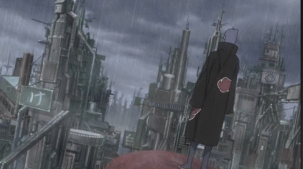

# ▸ Konan



<mark style="color:$success;"><strong>»</strong></mark> <strong>IDENTITÉ</strong> <mark style="color:$success;"><strong>«</strong></mark>

➜ <mark style="color:$success;">**Camp**</mark> • <mark style="color:red;">**Akatsuki**</mark>

> Objectif : gagner avec l'<mark style="color:red;">**Akatsuki**</mark>.

➜ <mark style="color:$success;">**Chakra**</mark> • `Nature`

> <mark style="color:green;">**Fûton**</mark> (voir [Natures de chakra](../../particularites/natures-de-chakra.md)).





<mark style="color:$success;"><strong>»</strong></mark> <strong>COMPÉTENCES</strong> <mark style="color:$success;"><strong>«</strong></mark>

➜ <mark style="color:$success;">**Connaissances**</mark> • `Particularités`

> <mark style="color:red;">**Konan**</mark> et [<mark style="color:red;">**Nagato**</mark>](nagato.md) se connaissent dès l'annonce des rôles : ils forment le réseau de reconnaissance de l'Akatsuki.
>
> Voir [Liste de l'Akatsuki](../../particularites/liste-de-lakatsuki.md).

➜ <mark style="color:$success;">**Effet**</mark> • `Passif`

> <mark style="color:red;">**Konan**</mark> possède l'effet <mark style="color:cyan;">**Vitesse I**</mark> permanent et ne subit aucun dégât de chute.





<mark style="color:$success;"><strong>»</strong></mark> <strong>CAPACITÉS</strong> <mark style="color:$success;"><strong>«</strong></mark>

➜ <mark style="color:$success;">**Shikigami no Mai**</mark> • `Clic-Droit` • ⌚ : 10 minutes

> <mark style="color:red;">**Konan**</mark> devient invisible et ne peut pas être frappée pendant **10 secondes**.

➜ <mark style="color:$success;">**Ailes d'Ange**</mark> • `Clic-Droit` • ⏳ : 1 minute • ⌚ : 10 minutes

> Des ailes de papier apparaissent dans le dos de <mark style="color:red;">**Konan**</mark>. Elle peut faire un dash de **15 blocs** avec un double saut, toutes les **15 secondes**.
>
> En réutilisant le pouvoir, elle lance des papiers explosifs qui infligent **1**<mark style="color:red;">**❤**</mark>.

➜ <mark style="color:$success;">**Tranchée de Papier**</mark> • `Clic-Droit` • ⌚ : 1x/partie

> <mark style="color:red;">**Konan**</mark> canalise pendant **5 secondes**, puis creuse une tranchée de **80 blocs** de profondeur sur **20 blocs** de large.
>
> Pendant **30 secondes**, des papiers explosifs tombent au fond et infligent **1**<mark style="color:red;">**❤**</mark> aux joueurs touchés.
>
> <mark style="color:red;">⚠ Bouger pendant la canalisation annule le pouvoir. Ce pouvoir est utilisable </mark><mark style="color:red;">**une seule fois par partie**</mark><mark style="color:red;">.</mark>

➜ <mark style="color:$success;">**Immobilisation**</mark> • `Clic-Droit` • ⌚ : 8 minutes

> <mark style="color:red;">**Konan**</mark> vise un joueur à moins de **20 blocs**. Il s'élève dans le ciel, couvert de papiers. Après **3 secondes**, les papiers explosent : il subit **1,5**<mark style="color:red;">**❤**</mark> et recule de **5 blocs**.

➜ <mark style="color:$success;">**Reconnaissance**</mark> • `Clic-Droit` • ⌚ : 8 minutes

> Pendant **1 minute**, des feuilles de papier tournent autour de <mark style="color:red;">**Konan**</mark>.
>
> Toutes les **10 secondes**, une feuille vole vers un joueur à moins de **8 blocs** et lui applique au hasard : <mark style="color:violet;">**Cécité**</mark> pendant **2 secondes**, <mark style="color:purple;">**Lenteur II**</mark> pendant **4 secondes**, <mark style="color:green;">**Poison I**</mark> pendant **3 secondes**, ou une explosion de **1**<mark style="color:red;">**❤**</mark>.



***

<figure><figcaption>
Illustration de Konan.
</figcaption></figure>

