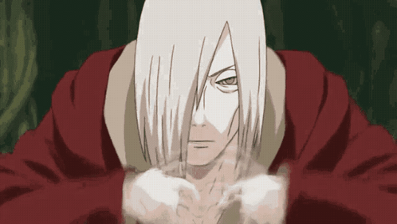

# ▸ Nagato



<mark style="color:$success;"><strong>»</strong></mark> <strong>IDENTITÉ</strong> <mark style="color:$success;"><strong>«</strong></mark>

➜ <mark style="color:$success;">**Camp**</mark> • <mark style="color:red;">**Akatsuki**</mark>

> Objectif : gagner avec l'<mark style="color:red;">**Akatsuki**</mark>.

➜ <mark style="color:$success;">**Chakra**</mark> • `Nature`

> <mark style="color:red;">**Katon**</mark>, <mark style="color:blue;">**Suiton**</mark>, <mark style="color:yellow;">**Raiton**</mark>, <mark style="color:green;">**Fûton**</mark> et <mark style="color:orange;">**Doton**</mark> (voir [Natures de chakra](../../particularites/natures-de-chakra.md)).





<mark style="color:$success;"><strong>»</strong></mark> <strong>COMPÉTENCES</strong> <mark style="color:$success;"><strong>«</strong></mark>

➜ <mark style="color:$success;">**Connaissances**</mark> • `Particularités`

> <mark style="color:red;">**Nagato**</mark> et [<mark style="color:red;">**Konan**</mark>](konan.md) se connaissent dès l'annonce des rôles : ils forment le réseau de reconnaissance de l'Akatsuki.
>
> Voir [Liste de l'Akatsuki](../../particularites/liste-de-lakatsuki.md).

➜ <mark style="color:$success;">**Effet**</mark> • `Passif`

> <mark style="color:red;">**Nagato**</mark> possède l'effet <mark style="color:red;">**Force I**</mark> permanent.

➜ <mark style="color:$success;">**Renvoi**</mark> • `Passif`

> <mark style="color:red;">**Nagato**</mark> renvoie toutes les flèches qui le touchent : le tireur subit les dégâts de sa propre flèche.

➜ <mark style="color:$success;">**Rinnegan**</mark> • `Passif`

> <mark style="color:red;">**Nagato**</mark> voit les joueurs proches en violet et il est prévenu quand un pouvoir est utilisé à moins de **20 blocs**. `/ns rinnegan` **active** ou **désactive** la [surbrillance](../../informations/lunar-client.md#surbrillance).
>
> * Tous les **15 coups**, le joueur frappé est cloué au sol pendant **0,2 seconde**.
> * Les pouvoirs utilisés contre <mark style="color:red;">**Nagato**</mark> ont **5 %** de chances d'échouer.





<mark style="color:$success;"><strong>»</strong></mark> <strong>CAPACITÉS</strong> <mark style="color:$success;"><strong>«</strong></mark>

➜ <mark style="color:$success;">**Gentōshin no Jutsu**</mark> • `/ns bague <joueur>`

> `/ns bague <joueur>` : <mark style="color:red;">**Nagato**</mark> parle pendant **1 minute** sur Mumble avec un membre de l'Akatsuki, peu importe la distance.

➜ <mark style="color:$success;">**Tendō**</mark> • `Clic-Droit`

> `Clic-Droit` : <mark style="color:red;">**Nagato**</mark> attire le joueur visé jusque devant lui.
>
> `Clic-Gauche` : il projette le joueur visé à **20 blocs**. Le joueur traverse les murs en cassant les blocs sur son passage.
>
> ➜ Les cooldowns sont séparés : **5 minutes** pour l'attraction, **6 minutes** pour la projection.

➜ <mark style="color:$success;">**Chibaku Tensei**</mark> • `Clic-Droit` • ⌚ : 15 minutes

> Les ennemis à moins de **15 blocs** sont aspirés vers le ciel et enfermés dans une sphère de pierre.
>
> **10 secondes** plus tard, ils sont projetés à **100 blocs**, chacun dans une direction différente.



***

<figure><figcaption>
Illustration de Nagato.
</figcaption></figure>

