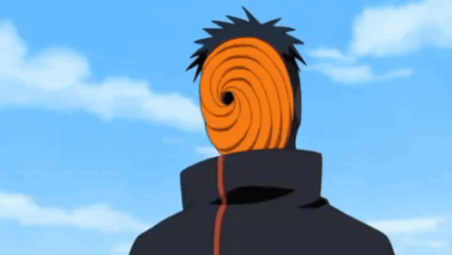

# ▸ Obito



<mark style="color:$success;"><strong>»</strong></mark> <strong>IDENTITÉ</strong> <mark style="color:$success;"><strong>«</strong></mark>

➜ <mark style="color:$success;">**Camp**</mark> • <mark style="color:red;">**Akatsuki**</mark>

> Objectif : gagner avec l'Akatsuki, ou en <mark style="color:yellow;">**duo**</mark> avec <mark style="color:yellow;">**Madara**</mark> s'il choisit le pacte 2.

➜ <mark style="color:$success;">**Chakra**</mark> • `Nature`

> <mark style="color:red;">**Katon**</mark> et <mark style="color:orange;">**Doton**</mark> (voir [Natures de chakra](../../particularites/natures-de-chakra.md)).





<mark style="color:$success;"><strong>»</strong></mark> <strong>COMPÉTENCES</strong> <mark style="color:$success;"><strong>«</strong></mark>

➜ <mark style="color:$success;">**Connaissances**</mark> • `Particularités`

> <mark style="color:red;">**Obito**</mark> ne connaît personne au départ. Il doit être reconnu par un membre du réseau de l'Akatsuki, puis il reconnaît les autres à son tour.
>
> Voir [Liste de l'Akatsuki](../../particularites/liste-de-lakatsuki.md).

➜ <mark style="color:$success;">**Pacte avec Madara**</mark> • `Condition de victoire`

> Si [<mark style="color:orange;">**Madara**</mark>](../solos/madara.md) choisit le pacte 2, <mark style="color:yellow;">**Obito**</mark> quitte l'Akatsuki et gagne uniquement en <mark style="color:yellow;">**duo**</mark> avec lui.
>
> * Il obtient <mark style="color:red;">**Force I**</mark> et une flèche vers [<mark style="color:green;">**Kakashi**</mark>](../shinobi/kakashi.md).
> * Tout ce qu'il écrit dans le chat va à [<mark style="color:orange;">**Madara**</mark>](../solos/madara.md).
> * Ils réunissent ensemble les Bijû avec `/ns jubi`.
>
> Voir [Jinchûriki des Six Chemins](../../particularites/jubi/jinchuriki-des-six-chemins.md).

➜ <mark style="color:$success;">**Sharingan**</mark> • `Passif`

> Tous les **15 coups** reçus, <mark style="color:red;">**Obito**</mark> prépare une esquive : le prochain coup d'épée qu'il reçoit est annulé, et la partie de son corps touchée disparaît dans une spirale noire.
>
> <mark style="color:red;">⚠ </mark><mark style="color:red;">**Obito**</mark><mark style="color:red;"> ne garde qu'une esquive à la fois.</mark>





<mark style="color:$success;"><strong>»</strong></mark> <strong>CAPACITÉS</strong> <mark style="color:$success;"><strong>«</strong></mark>

➜ <mark style="color:$success;">**Kamui**</mark> • `Clic-Gauche` • ⌚ : 10 minutes

> `Clic-Gauche` : <mark style="color:red;">**Obito**</mark> entre dans Kamui, ou en sort, quand il veut et sans cooldown, sauf en combat.
>
> `Clic-Droit` : il envoie dans Kamui un joueur à moins de **30 blocs** pendant **5 minutes**, ou le fait sortir. Chacun ressort là où il est entré.

➜ <mark style="color:$success;">**Katon — Bombes du Vortex**</mark> • `Clic-Droit` • ⌚ : 5 minutes

> Trois boules de magma tournent autour d'<mark style="color:red;">**Obito**</mark> pendant **1 minute**. Chaque `Clic-Droit` lance une boule jusqu'à **20 blocs**, au plus une toutes les **2 secondes**.
>
> Elle explose sur le premier joueur ou bloc touché : les joueurs à moins de **2 blocs** subissent **½**<mark style="color:red;">**❤**</mark> et brûlent pendant **3 secondes**.
>
> <mark style="color:red;">⚠ Les boules non lancées disparaissent au bout de </mark><mark style="color:red;">**1 minute**</mark><mark style="color:red;">.</mark>

➜ <mark style="color:$success;">**Double Mangekyō Sharingan**</mark> • `Clic-Droit`

> À la mort de [<mark style="color:green;">**Kakashi**</mark>](../shinobi/kakashi.md), une flèche montre son cadavre à <mark style="color:red;">**Obito**</mark>. Il a **5 minutes** pour faire `Clic-Droit` dessus et prendre son Sharingan, avant que le corps ne se décompose.
>
> Avec ce deuxième Sharingan, <mark style="color:red;">**Obito**</mark> obtient le **Susano** jusqu'à la fin de la partie.

➜ <mark style="color:$success;">**Susano**</mark> • `Clic-Droit` • ⏳ : 2 minutes • ⌚ : 10 minutes

> Une armure bleue en forme de squelette entoure <mark style="color:red;">**Obito**</mark>, qui obtient <mark style="color:blue;">**Résistance I**</mark>. Les coups qu'il reçoit ont **20 %** de chances de passer à travers son corps.
>
> ➜ <mark style="color:$success;">**Shurikens**</mark> • `Clic-Droit` • ⌚ : 30 secondes
>
> > <mark style="color:red;">**Obito**</mark> les dirige avec son curseur. Ils explosent à l'impact et infligent **2**<mark style="color:red;">**❤**</mark>.
>
> ➜ <mark style="color:$success;">**Zone**</mark> • `Clic-Gauche` • ⌚ : 15 secondes
>
> > les blocs visés sont détruits.

➜ <mark style="color:$success;">**Le Rinnegan de Nagato**</mark> • `Clic-Droit`

> À la mort de [<mark style="color:red;">**Nagato**</mark>](nagato.md), une flèche montre son cadavre à <mark style="color:red;">**Obito**</mark>. Il a **5 minutes** pour faire `Clic-Droit` dessus et prendre son Rinnegan. Après ce délai, le cadavre disparaît.
>
> Avec le Rinnegan, <mark style="color:red;">**Obito**</mark> obtient le même passif que [<mark style="color:red;">**Nagato**</mark>](nagato.md) :
>
> * Il voit les joueurs proches en violet (`/ns rinnegan` pour l'**activer** ou la **désactiver**), et il est prévenu quand un pouvoir est utilisé à moins de **20 blocs**.
> * Tous les **15 coups**, le joueur frappé est cloué au sol pendant **0,2 seconde**.
> * Les pouvoirs utilisés contre <mark style="color:red;">**Obito**</mark> ont **5 %** de chances d'échouer.



***

<figure><figcaption>
Illustration de Obito.
</figcaption></figure>

