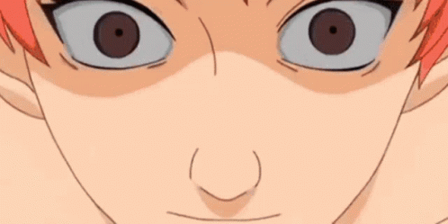

# ▸ Sasori



<mark style="color:$success;"><strong>»</strong></mark> <strong>IDENTITÉ</strong> <mark style="color:$success;"><strong>«</strong></mark>

➜ <mark style="color:$success;">**Camp**</mark> • <mark style="color:red;">**Akatsuki**</mark>

> Objectif : gagner avec l'<mark style="color:red;">**Akatsuki**</mark>.

➜ <mark style="color:$success;">**Chakra**</mark> • `Nature`

> <mark style="color:orange;">**Doton**</mark> (voir [Natures de chakra](../../particularites/natures-de-chakra.md)).





<mark style="color:$success;"><strong>»</strong></mark> <strong>COMPÉTENCES</strong> <mark style="color:$success;"><strong>«</strong></mark>

➜ <mark style="color:$success;">**Connaissances**</mark> • `Particularités`

> <mark style="color:red;">**Sasori**</mark> ne connaît personne au départ. Il doit être reconnu par un membre du réseau de l'Akatsuki, puis il reconnaît les autres à son tour.
>
> Voir [Liste de l'Akatsuki](../../particularites/liste-de-lakatsuki.md).

➜ <mark style="color:$success;">**Corps Artificiel**</mark> • `Passif` • ⌚ : 1 minute

> Quand <mark style="color:red;">**Sasori**</mark> pare avec son épée, il lance l'élément du moment, qui change toutes les **10 secondes** :
>
> * **Feu :** il enflamme les joueurs à moins de **10 blocs**.
> * **Eau :** il repousse le joueur visé de **10 blocs**.





<mark style="color:$success;"><strong>»</strong></mark> <strong>CAPACITÉS</strong> <mark style="color:$success;"><strong>«</strong></mark>

➜ <mark style="color:$success;">**Hitokugutsu**</mark> • `Clic-Droit`

> `Clic-Droit` sur le cadavre d'un joueur qu'il a tué : <mark style="color:red;">**Sasori**</mark> en fait une marionnette de **5**<mark style="color:red;">**❤**</mark>, qui attaque le dernier joueur qu'il a frappé.
>
> ⚠ <mark style="color:red;">**Sasori**</mark> peut avoir **2** marionnettes de joueurs au maximum.

➜ <mark style="color:$success;">**Hiruko**</mark> • `Clic-Droit` • ⌚ : 5 minutes

> <mark style="color:red;">**Sasori**</mark> invoque une marionnette de **8**<mark style="color:red;">**❤**</mark>, qui tire des flèches de <mark style="color:green;">**Poison I**</mark> tout autour d'elle.
>
> ⚠ Hiruko coûte **1**<mark style="color:red;">**❤**</mark> maximum à <mark style="color:red;">**Sasori**</mark>, rendu **1 minute** après sa mort. Une seule Hiruko à la fois.

➜ <mark style="color:$success;">**Satetsu**</mark> • `Clic-Droit` • ⏳ : 1 minute • ⌚ : 8 minutes

> <mark style="color:red;">**Sasori**</mark> invoque une marionnette qui trace des lignes sur **20 blocs** autour d'elle. Les traverser donne <mark style="color:green;">**Poison I**</mark> pendant **3 secondes**.

➜ <mark style="color:$success;">**Transfert du Cœur**</mark> • `Clic-Droit` • ⌚ : 1x/partie

> Si <mark style="color:red;">**Sasori**</mark> meurt alors qu'une de ses marionnettes de joueurs est en vie, il devient un bébé zombie avec <mark style="color:cyan;">**Vitesse II**</mark>, guidé par une flèche.
>
> En rejoignant la marionnette, il prend sa place et revient en jeu.
>
> ⚠ S'il est tué en bébé zombie, sa mort est définitive. Utilisable **une seule fois par partie**.



***

<figure><figcaption>
Illustration de Sasori.
</figcaption></figure>

