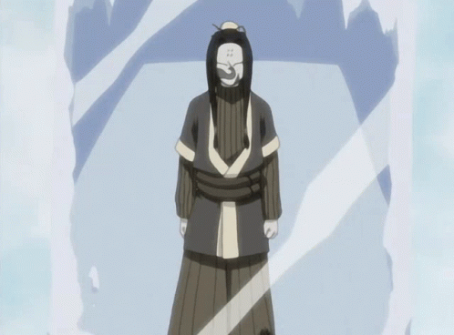

# ▸ Haku



<mark style="color:$success;"><strong>»</strong></mark> <strong>IDENTITÉ</strong> <mark style="color:$success;"><strong>«</strong></mark>

➜ <mark style="color:$success;">**Camp**</mark> • <mark style="color:blue;">**Réincarnés**</mark>

> Objectif : gagner avec les <mark style="color:blue;">**Réincarnés**</mark>.

➜ <mark style="color:$success;">**Chakra**</mark> • `Nature`

> <mark style="color:blue;">**Suiton**</mark> (voir [Natures de chakra](../../particularites/natures-de-chakra.md)).





<mark style="color:$success;"><strong>»</strong></mark> <strong>COMPÉTENCES</strong> <mark style="color:$success;"><strong>«</strong></mark>

➜ <mark style="color:$success;">**Connaissances**</mark> • `Particularités`

> <mark style="color:blue;">**Haku**</mark> ne connaît aucun allié au départ. Il rejoint la liste des Réincarnés quand [<mark style="color:blue;">**Kabuto**</mark>](kabuto.md) le découvre.
>
> Voir [Liste des Réincarnés](../../particularites/liste-des-reincarnes.md).

➜ <mark style="color:$success;">**Effet**</mark> • `Passif`

> <mark style="color:blue;">**Haku**</mark> possède <mark style="color:cyan;">**Vitesse I**</mark> en permanence.





<mark style="color:$success;"><strong>»</strong></mark> <strong>CAPACITÉS</strong> <mark style="color:$success;"><strong>«</strong></mark>

➜ <mark style="color:$success;">**Nether Star « Glace »**</mark> • `Clic-Gauche` / `Clic-Droit`

> Ces pouvoirs sont réunis sur une Nether Star : **Makyō Hyōshō**, **Lancer de Senbon**, **Sensatsu Suishō**.
>
> * `Clic-Gauche` : passer au pouvoir suivant.
> * `Clic-Droit` : utiliser le pouvoir sélectionné.

➜ <mark style="color:$success;">**Makyō Hyōshō — Miroirs de Glace**</mark> • `Clic-Droit` • Nether Star « Glace » • ⏳ : 1 minute • ⌚ : 15 minutes

> <mark style="color:blue;">**Haku**</mark> crée autour de lui un dôme de glace incassable de **50 blocs** de diamètre, fermé de toutes parts, pendant **1 minute**.
>
> ➜ Réutiliser le pouvoir, au plus toutes les **5 secondes**, téléporte <mark style="color:blue;">**Haku**</mark> contre la paroi du dôme qu'il vise.

➜ <mark style="color:$success;">**Lancer de Senbon**</mark> • `Clic-Droit` • Nether Star « Glace »

> <mark style="color:blue;">**Haku**</mark> possède **3 aiguilles**, affichées dans sa barre d'action. `Clic-Droit` lance une aiguille vers le point visé : le joueur touché subit <mark style="color:green;">**Poison II**</mark> pendant **2 secondes**.
>
> L'aiguille tombe au sol, ou aux pieds du joueur touché. <mark style="color:blue;">**Haku**</mark> la récupère en passant dessus ; sinon, elle revient seule au bout de **30 secondes**.
>
> <mark style="color:red;">⚠ Un lancer toutes les </mark><mark style="color:red;">**10 secondes**</mark><mark style="color:red;"> au plus.</mark>

➜ <mark style="color:$success;">**Sensatsu Suishō**</mark> • `Clic-Droit` • Nether Star « Glace » • ⌚ : 10 minutes

> Une pluie d'aiguilles tombe du ciel dans un rayon de **20 blocs** autour de <mark style="color:blue;">**Haku**</mark>. Chaque joueur touché subit <mark style="color:green;">**Poison II**</mark> pendant **3 secondes**.



***

<figure><figcaption>
Illustration de Haku.
</figcaption></figure>

