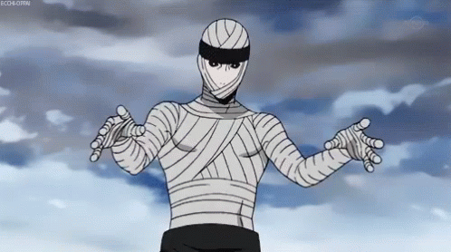

# ▸ Mû



<mark style="color:$success;"><strong>»</strong></mark> <strong>IDENTITÉ</strong> <mark style="color:$success;"><strong>«</strong></mark>

➜ <mark style="color:$success;">**Camp**</mark> • <mark style="color:blue;">**Réincarnés**</mark>

> Objectif : gagner avec les <mark style="color:blue;">**Réincarnés**</mark>.

➜ <mark style="color:$success;">**Chakra**</mark> • `Nature`

> <mark style="color:orange;">**Doton**</mark> et <mark style="color:green;">**Fûton**</mark> (voir [Natures de chakra](../../particularites/natures-de-chakra.md)).





<mark style="color:$success;"><strong>»</strong></mark> <strong>COMPÉTENCES</strong> <mark style="color:$success;"><strong>«</strong></mark>

➜ <mark style="color:$success;">**Connaissances**</mark> • `Particularités`

> <mark style="color:blue;">**Mû**</mark> ne connaît aucun allié au départ. Il rejoint la liste des Réincarnés quand [<mark style="color:blue;">**Kabuto**</mark>](kabuto.md) le découvre.
>
> Voir [Liste des Réincarnés](../../particularites/liste-des-reincarnes.md).

➜ <mark style="color:$success;">**Bunretsu — La Division**</mark> • `Particularités`

> Une fois par partie, un coup mortel scinde <mark style="color:blue;">**Mû**</mark> en deux.
>
> Un clone reste à l'endroit de sa mort et marche tout droit sur **20 blocs** avant de disparaître, pendant que le vrai <mark style="color:blue;">**Mû**</mark> réapparaît avec **3**<mark style="color:red;">**❤**</mark> à un endroit au hasard de la carte.
>
> <mark style="color:red;">⚠ Le cooldown du Jinton passe ensuite à </mark><mark style="color:red;">**16 minutes**</mark><mark style="color:red;"> jusqu'à la fin de la partie.</mark>





<mark style="color:$success;"><strong>»</strong></mark> <strong>CAPACITÉS</strong> <mark style="color:$success;"><strong>«</strong></mark>

➜ <mark style="color:$success;">**Jinton — Cône de Désintégration**</mark> • `Clic-Droit` • ⌚ : 8 minutes

> <mark style="color:blue;">**Mû**</mark> concentre son chakra pendant **5 secondes** : des blocs de terre et de roche volent vers lui. Il projette ensuite un cône devant lui, jusqu'à **30 blocs**.
>
> Les joueurs touchés subissent **2**<mark style="color:red;">**❤**</mark> et <mark style="color:$secondary;">**Wither II**</mark> pendant **3 secondes**.

➜ <mark style="color:$success;">**Mujin Meisai — Camouflage**</mark> • `Clic-Droit`

> <mark style="color:blue;">**Mû**</mark> devient invisible ou redevient visible quand il le veut, hors combat. Invisible, son armure et l'objet qu'il tient sont cachés.
>
> <mark style="color:red;">⚠ Pendant le camouflage, </mark><mark style="color:red;">**Mû**</mark><mark style="color:red;"> n'a aucune protection d'armure.</mark>

➜ <mark style="color:$success;">**Doton — Maîtrise du Poids**</mark> • `Clic-Droit`

> Chaque utilisation passe à l'état suivant, après **5 secondes** :
>
> * **Léger :** <mark style="color:cyan;">**Vitesse I**</mark> ;
> * **Normal :** aucun effet ;
> * **Lourd :** <mark style="color:blue;">**Résistance I**</mark>.



***

<figure><figcaption>
Illustration de Mû.
</figcaption></figure>

