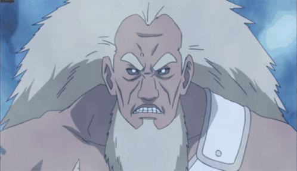

# ▸ Troisième Raikage



<mark style="color:$success;"><strong>»</strong></mark> <strong>IDENTITÉ</strong> <mark style="color:$success;"><strong>«</strong></mark>

➜ <mark style="color:$success;">**Camp**</mark> • <mark style="color:blue;">**Réincarnés**</mark>

> Objectif : gagner avec les <mark style="color:blue;">**Réincarnés**</mark>.

➜ <mark style="color:$success;">**Chakra**</mark> • `Nature`

> <mark style="color:yellow;">**Raiton**</mark> (voir [Natures de chakra](../../particularites/natures-de-chakra.md)).





<mark style="color:$success;"><strong>»</strong></mark> <strong>COMPÉTENCES</strong> <mark style="color:$success;"><strong>«</strong></mark>

➜ <mark style="color:$success;">**Connaissances**</mark> • `Particularités`

> <mark style="color:blue;">**Troisième Raikage**</mark> ne connaît aucun allié au départ. Il rejoint la liste des Réincarnés quand [<mark style="color:blue;">**Kabuto**</mark>](kabuto.md) le découvre.
>
> Voir [Liste des Réincarnés](../../particularites/liste-des-reincarnes.md).

➜ <mark style="color:$success;">**Effet**</mark> • `Passif`

> Le <mark style="color:blue;">**Troisième Raikage**</mark> possède <mark style="color:cyan;">**Vitesse I**</mark> en permanence.

➜ <mark style="color:$success;">**Armure de Foudre**</mark> • `/ns armure`

> Avec `/ns armure`, le <mark style="color:blue;">**Troisième Raikage**</mark> **active** ou **désactive** son armure.
>
> Sa jauge de **100** points de foudre perd **2** points par seconde quand l'armure est active, et en regagne **2** toutes les **5 secondes** quand elle est coupée.
>
> Pendant l'armure, les coups d'épée qu'il reçoit sont réduits de **10 %** et les flèches de **50 %**.
>
> Tous les **5 coups d'épée** reçus, il gagne une charge électrique, **4** au maximum, affichée au-dessus de sa barre d'inventaire.
>
> <mark style="color:red;">⚠ Les charges disparaissent quand l'armure est coupée.</mark>

➜ <mark style="color:$success;">**Dernier Rempart**</mark> • `Passif`

> Si la jauge tombe à **0** pendant l'armure, une dernière impulsion repousse de **4 blocs** les joueurs à moins de **3 blocs**, puis l'armure se coupe.
>
> <mark style="color:red;">⚠ Il faut ensuite </mark><mark style="color:red;">**20 points**</mark><mark style="color:red;"> de foudre pour la réactiver.</mark>





<mark style="color:$success;"><strong>»</strong></mark> <strong>CAPACITÉS</strong> <mark style="color:$success;"><strong>«</strong></mark>

➜ <mark style="color:$success;">**Nukite — La Lance de l'Enfer**</mark> • `Clic-Droit` • ⌚ : 3 minutes

> Pendant l'armure, le <mark style="color:blue;">**Troisième Raikage**</mark> utilise toutes ses charges pour foncer dans la direction visée. Le premier joueur touché subit les dégâts et arrête le dash, comme un bloc plein :
>
> * **1 charge :** **8 blocs**, **1**<mark style="color:red;">**❤**</mark>.
> * **2 charges :** **12 blocs**, **1,5**<mark style="color:red;">**❤**</mark>.
> * **3 charges :** **16 blocs**, **2**<mark style="color:red;">**❤**</mark>.
> * **4 charges :** **20 blocs**, **2,5**<mark style="color:red;">**❤**</mark>.
>
> <mark style="color:red;">⚠ Toutes les charges sont utilisées, même si le dash ne touche personne.</mark>

➜ <mark style="color:$success;">**Kuroi Kaminari — Foudre Noire**</mark> • `Clic-Droit` • ⌚ : 5 minutes

> Un éclair noir frappe l'endroit visé jusqu'à **10 blocs**. Les joueurs à moins de **4 blocs** de l'impact subissent **2**<mark style="color:red;">**❤**</mark> et <mark style="color:purple;">**Lenteur II**</mark> pendant **3 secondes**.



***

<figure><figcaption>
Illustration de Troisième Raikage.
</figcaption></figure>

