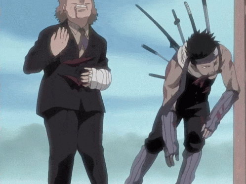

# ▸ Zabuza



<mark style="color:$success;"><strong>»</strong></mark> <strong>IDENTITÉ</strong> <mark style="color:$success;"><strong>«</strong></mark>

➜ <mark style="color:$success;">**Camp**</mark> • <mark style="color:blue;">**Réincarnés**</mark>

> Objectif : gagner avec les <mark style="color:blue;">**Réincarnés**</mark>.

➜ <mark style="color:$success;">**Chakra**</mark> • `Nature`

> <mark style="color:blue;">**Suiton**</mark> (voir [Natures de chakra](../../particularites/natures-de-chakra.md)).





<mark style="color:$success;"><strong>»</strong></mark> <strong>COMPÉTENCES</strong> <mark style="color:$success;"><strong>«</strong></mark>

➜ <mark style="color:$success;">**Connaissances**</mark> • `Particularités`

> <mark style="color:blue;">**Zabuza**</mark> ne connaît aucun allié au départ. Il rejoint la liste des Réincarnés quand [<mark style="color:blue;">**Kabuto**</mark>](kabuto.md) le découvre.
>
> Voir [Liste des Réincarnés](../../particularites/liste-des-reincarnes.md).

➜ <mark style="color:$success;">**Kubikiribōchō**</mark> • `Particularités`

> <mark style="color:blue;">**Zabuza**</mark> possède une épée en diamant **Tranchant IV**, Kubikiribōchō. Chacun de ses coups avec cette épée a **15 %** de chances de lui rendre **½**<mark style="color:red;">**❤**</mark>.





<mark style="color:$success;"><strong>»</strong></mark> <strong>CAPACITÉS</strong> <mark style="color:$success;"><strong>«</strong></mark>

➜ <mark style="color:$success;">**Kirigakure no Jutsu**</mark> • `Clic-Droit` • ⏳ : 1 minute • ⌚ : 10 minutes

> <mark style="color:blue;">**Zabuza**</mark> crée un brouillard de **40 blocs** de rayon pendant **1 minute**. Les autres joueurs dedans subissent <mark style="color:violet;">**Cécité**</mark> et <mark style="color:purple;">**Lenteur I**</mark> tant qu'ils y restent.
>
> <mark style="color:blue;">**Zabuza**</mark> voit les joueurs du brouillard en surbrillance bleue. Eux ne le voient qu'à **4 blocs** ou moins.

➜ <mark style="color:$success;">**Suirō no Jutsu**</mark> • `Clic-Droit` • ⌚ : 8 minutes

> <mark style="color:blue;">**Zabuza**</mark> enferme un joueur à moins de **15 blocs** dans un tourbillon d'eau qui le soulève de **3 blocs** pendant **3 secondes**. Le joueur est immobilisé et étouffe : il perd **½**<mark style="color:red;">**❤**</mark> par seconde.

➜ <mark style="color:$success;">**Suiryūdan no Jutsu**</mark> • `Clic-Droit` • ⌚ : 10 minutes

> Un dragon d'eau tourne autour de <mark style="color:blue;">**Zabuza**</mark> en grands cercles de plus en plus larges, jusqu'à **30 blocs**.
>
> Chaque joueur touché subit **1,5**<mark style="color:red;">**❤**</mark> et il est projeté à **10 blocs**, une seule fois par utilisation.



***

<figure><figcaption>
Illustration de Zabuza.
</figcaption></figure>

