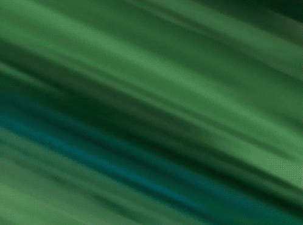

# ▸ Chôji



<mark style="color:$success;"><strong>»</strong></mark> <strong>IDENTITÉ</strong> <mark style="color:$success;"><strong>«</strong></mark>

➜ <mark style="color:$success;">**Camp**</mark> • <mark style="color:green;">**Shinobi**</mark>

> Objectif : gagner avec les <mark style="color:green;">**Shinobi**</mark>.

➜ <mark style="color:$success;">**Chakra**</mark> • `Nature`

> <mark style="color:orange;">**Doton**</mark> (voir [Natures de chakra](../../particularites/natures-de-chakra.md)).





<mark style="color:$success;"><strong>»</strong></mark> <strong>COMPÉTENCES</strong> <mark style="color:$success;"><strong>«</strong></mark>

➜ <mark style="color:$success;">**Baika no Jutsu**</mark> • `Passif`

> Un joueur qui frappe <mark style="color:green;">**Chôji**</mark> a **10 %** de chances d'être repoussé de **5 blocs**.





<mark style="color:$success;"><strong>»</strong></mark> <strong>CAPACITÉS</strong> <mark style="color:$success;"><strong>«</strong></mark>

➜ <mark style="color:$success;">**Nikudan Sensha**</mark> • `Clic-Droit` • ⏳ : 2 minutes • ⌚ : 10 minutes

> <mark style="color:green;">**Chôji**</mark> se transforme en boule de **30 PV** (**15**<mark style="color:red;">**❤**</mark>) qui roule là où il regarde, à **3 blocs par seconde**, et grimpe les obstacles jusqu'à **3 blocs**.
>
> Chaque joueur écrasé subit **1**<mark style="color:red;">**❤**</mark> et il est projeté à **20 blocs**.
>
> Réutiliser l'objet lui rend sa forme normale.
>
> <mark style="color:red;">⚠ Dans la boule, </mark><mark style="color:red;">**Chôji**</mark><mark style="color:red;"> est invisible mais ne peut ni frapper ni tirer. Si la boule perd ses 30 PV, elle disparaît.</mark>

➜ <mark style="color:$success;">**Chō Harite**</mark> • `Clic-Droit` • ⌚ : 5 minutes

> <mark style="color:green;">**Chôji**</mark> frappe le sol : les joueurs à moins de **15 blocs** sont soulevés d'**1 bloc**, subissent **1**<mark style="color:red;">**❤**</mark> et <mark style="color:green;">**Nausée**</mark> pendant **5 secondes**.

➜ <mark style="color:$success;">**Mode Papillon**</mark> • `Clic-Droit` • ⏳ : 2 minutes • ⌚ : 10 minutes

> Des ailes bleues apparaissent dans le dos de <mark style="color:green;">**Chôji**</mark> :
>
> * tous les **10 coups**, un second coup part tout seul ;
> * accroupi en l'air, il plane vers l'avant ;
> * frappé dans le dos, il a **10 %** de chances de projeter l'attaquant à **5 blocs**.
>
> <mark style="color:red;">⚠ Baika no Jutsu est désactivé pendant le mode.</mark>



***

<figure><figcaption>
Illustration de Chôji.
</figcaption></figure>

