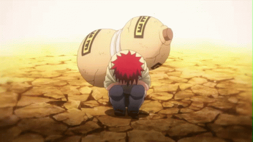

# ▸ Gaara



<mark style="color:$success;"><strong>»</strong></mark> <strong>IDENTITÉ</strong> <mark style="color:$success;"><strong>«</strong></mark>

➜ <mark style="color:$success;">**Camp**</mark> • <mark style="color:green;">**Shinobi**</mark>

> Objectif : gagner avec les <mark style="color:green;">**Shinobi**</mark>.

➜ <mark style="color:$success;">**Chakra**</mark> • `Nature`

> <mark style="color:orange;">**Doton**</mark> et <mark style="color:green;">**Fûton**</mark> (voir [Natures de chakra](../../particularites/natures-de-chakra.md)).





<mark style="color:$success;"><strong>»</strong></mark> <strong>COMPÉTENCES</strong> <mark style="color:$success;"><strong>«</strong></mark>

➜ <mark style="color:$success;">**Réserve de sable**</mark> • `Passif`

> <mark style="color:green;">**Gaara**</mark> commence avec **500** de sable (**1 728** au maximum) et en regagne **5** toutes les **2 secondes**. Ses pouvoirs consomment ce sable.
>
> `/ns sable` ouvre sa réserve : il peut y déposer du sable ramassé.
>
> <mark style="color:red;">⚠ Le sable ne se régénère pas pendant un pouvoir qui en consomme.</mark>





<mark style="color:$success;"><strong>»</strong></mark> <strong>CAPACITÉS</strong> <mark style="color:$success;"><strong>«</strong></mark>

➜ <mark style="color:$success;">**Nether Star « Sable »**</mark> • `Clic-Gauche` / `Clic-Droit`

> Ces pouvoirs sont réunis sur une Nether Star : **Bouclier de Sable**, **Nuage de Sable**, **Troisième Œil**, **Sarcophage de Sable**.
>
> * `Clic-Gauche` : passer au pouvoir suivant.
> * `Clic-Droit` : utiliser le pouvoir sélectionné.

➜ <mark style="color:$success;">**Bouclier de Sable**</mark> • `Clic-Droit` • Nether Star « Sable » • ⌚ : 5 secondes

> <mark style="color:green;">**Gaara**</mark> **active** ou **désactive** son bouclier. Tant qu'il est actif, un coup sur **10** reçus est annulé. Coût : **5** sable par seconde.

➜ <mark style="color:$success;">**Nuage de Sable**</mark> • `Clic-Droit` • Nether Star « Sable » • ⌚ : 1 minute

> <mark style="color:green;">**Gaara**</mark> s'élève à **10 blocs** sur une plateforme de sable de **5 × 5**. Quand il se déplace, une nouvelle plateforme se forme sous lui. Coût : **50** sable par plateforme.

➜ <mark style="color:$success;">**Troisième Œil**</mark> • `Clic-Droit` • Nether Star « Sable » • ⌚ : 10 minutes

> <mark style="color:green;">**Gaara**</mark> pose un œil sur le joueur visé.
>
> Il est prévenu quand ce joueur utilise un pouvoir, mange une pomme d'or, frappe ou est frappé (avec le pseudo de l'autre joueur), ou change de camp.
>
> Coût : **100** sable par minute.

➜ <mark style="color:$success;">**Sarcophage de Sable**</mark> • `Clic-Droit` • Nether Star « Sable » • ⌚ : 5 minutes

> <mark style="color:green;">**Gaara**</mark> enferme le joueur visé dans une sphère de sable pendant **3 secondes**. Coût : **300** sable.
>
> ➜ <mark style="color:$success;">**Compression**</mark> • `Clic-Droit` • ⌚ : 150 sable
>
> > la sphère explose, inflige **2**<mark style="color:red;">**❤**</mark> et libère le joueur.



***

<figure><figcaption>
Illustration de Gaara.
</figcaption></figure>

