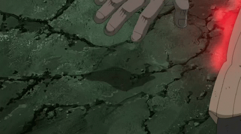

# ▸ Gaï



<mark style="color:$success;"><strong>»</strong></mark> <strong>IDENTITÉ</strong> <mark style="color:$success;"><strong>«</strong></mark>

➜ <mark style="color:$success;">**Camp**</mark> • <mark style="color:green;">**Shinobi**</mark>

> Objectif : gagner avec les <mark style="color:green;">**Shinobi**</mark>.

➜ <mark style="color:$success;">**Chakra**</mark> • `Nature`

> une nature aléatoire (voir [Natures de chakra](../../particularites/natures-de-chakra.md)).





<mark style="color:$success;"><strong>»</strong></mark> <strong>COMPÉTENCES</strong> <mark style="color:$success;"><strong>«</strong></mark>

➜ <mark style="color:$success;">**Rafales**</mark> • `Passif`

> Tous les **15 coups**, <mark style="color:green;">**Gaï**</mark> inflige le **double** des dégâts.





<mark style="color:$success;"><strong>»</strong></mark> <strong>CAPACITÉS</strong> <mark style="color:$success;"><strong>«</strong></mark>

➜ <mark style="color:$success;">**Étoile « Portes »**</mark> • `Clic-Gauche` / `Clic-Droit`

> Les Portes sont réunies sur un même objet.
>
> * `Clic-Gauche` : passer à la Porte suivante.
> * `Clic-Droit` : ouvrir la Porte sélectionnée.
>
> Pendant la Huitième Porte, l'objet devient **Gaï de la Nuit**.

➜ <mark style="color:$success;">**Disparition**</mark> • `Clic-Droit` • ⌚ : 5 minutes

> <mark style="color:green;">**Gaï**</mark> se téléporte dans le dos du joueur visé, à moins de **15 blocs**.

➜ <mark style="color:$success;">**Les Huit Portes**</mark> • `Clic-Droit` • Étoile « Portes »

> <mark style="color:green;">**Gaï**</mark> ouvre les Portes avec son objet.
>
> <mark style="color:red;">⚠ Une seule Porte peut être ouverte à la fois. Chaque Porte garde son propre cooldown.</mark>
>
> **Troisième Porte** • ⏳ 1 min 30 s • ⌚ 8 minutes
>
> * **2**<mark style="color:red;">**❤**</mark> d'<mark style="color:yellow;">absorption</mark>, rendus **15 secondes** après les avoir perdus.
> * **+2 %** de <mark style="color:cyan;">Vitesse</mark> par seconde, jusqu'à **20 %**.
>
> <mark style="color:red;">⚠ Une pomme d'or ne monte pas l'absorption au-delà de </mark><mark style="color:red;">**2**</mark><mark style="color:red;">**❤**</mark><mark style="color:red;">. Le bonus de Vitesse retombe à </mark><mark style="color:red;">**0 %**</mark><mark style="color:red;"> à chaque coup reçu.</mark>
>
> **Sixième Porte** • ⏳ 1 minute • ⌚ 12 minutes
>
> * Les effets de la Troisième Porte.
> * Tous les **10 coups** : un coup **×1,2** en **no hit delay**, avec **5 %** de chances d'enflammer.
> * Quand il est frappé : **5 %** de chances de se téléporter dans le dos de l'attaquant.
>
> **Huitième Porte** • ⏳ 3 minutes
>
> * <mark style="color:red;">**Force I**</mark> et **+3**<mark style="color:red;">**❤**</mark>.
> * Les effets des Troisième et Sixième Portes.
> * La <mark style="color:red;">Force</mark> des autres joueurs ne lui inflige pas de dégâts en plus.
> * `Clic-Droit` avec l'épée, toutes les **5 secondes** : un projectile invisible qui inflige **½**<mark style="color:red;">**❤**</mark>.
>
> **Fin de la Huitième Porte**
>
> <mark style="color:red;">⚠ À la fin de la Huitième Porte, </mark><mark style="color:red;">**Gaï**</mark><mark style="color:red;"> meurt.</mark>
>
> Si [<mark style="color:green;">**Naruto**</mark>](naruto.md) se trouve à moins de **50 blocs**, <mark style="color:green;">**Gaï**</mark> revient avec **7**<mark style="color:red;">**❤**</mark> maximum, mais sans pouvoirs ni passifs.

➜ <mark style="color:$success;">**Gaï de la Nuit**</mark> • `Clic-Droit` • Étoile « Portes »

> **Activation**
>
> Pendant la **Huitième Porte**, <mark style="color:green;">**Gaï**</mark> vise un joueur.
>
> **Effet**
>
> * <mark style="color:green;">**Gaï**</mark> s'élance avec sa cible sur **50 blocs**, dans une traînée d'explosions.
> * La cible subit **4**<mark style="color:red;">**❤**</mark>.
> * Pendant **15 secondes**, les coups de <mark style="color:green;">**Gaï**</mark> enflamment.
>
> <mark style="color:red;">⚠ L'attaque retire </mark><mark style="color:red;">**1 minute**</mark><mark style="color:red;"> à la durée restante de la Huitième Porte.</mark>



***

<figure><figcaption>
Illustration de Gaï.
</figcaption></figure>

