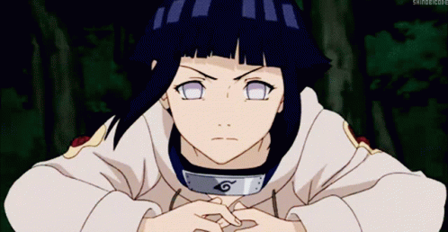

# ▸ Hinata



<mark style="color:$success;"><strong>»</strong></mark> <strong>IDENTITÉ</strong> <mark style="color:$success;"><strong>«</strong></mark>

➜ <mark style="color:$success;">**Camp**</mark> • <mark style="color:green;">**Shinobi**</mark>

> Objectif : gagner avec les <mark style="color:green;">**Shinobi**</mark>.

➜ <mark style="color:$success;">**Chakra**</mark> • `Nature`

> une nature aléatoire (voir [Natures de chakra](../../particularites/natures-de-chakra.md)).





<mark style="color:$success;"><strong>»</strong></mark> <strong>COMPÉTENCES</strong> <mark style="color:$success;"><strong>«</strong></mark>

➜ <mark style="color:$success;">**Byakugan**</mark> • `Passif`

> <mark style="color:green;">**Hinata**</mark> voit les joueurs proches en surbrillance blanche. Une montre s'affiche au-dessus de ceux dont un pouvoir est en cooldown.
>
> `/ns byakugan` **active** ou **désactive** la surbrillance.

➜ <mark style="color:$success;">**Hakke Kûshô**</mark> • `Passif`

> Tous les **10 coups**, <mark style="color:green;">**Hinata**</mark> inflige **×1,2** les dégâts, sans délai d'invulnérabilité.





<mark style="color:$success;"><strong>»</strong></mark> <strong>CAPACITÉS</strong> <mark style="color:$success;"><strong>«</strong></mark>

➜ <mark style="color:$success;">**Jûken**</mark> • `Clic-Droit` • ⏳ : 2 minutes • ⌚ : 10 minutes

> Pendant **2 minutes**, toutes les **10 secondes**, un coup de <mark style="color:green;">**Hinata**</mark> touche une partie du corps au hasard :
>
> * **Bras :** le joueur ne peut plus frapper pendant **2 secondes**.
> * **Cerveau :** <mark style="color:violet;">**Cécité**</mark> pendant **2 secondes**.
> * **Jambes :** <mark style="color:purple;">**Lenteur**</mark> pendant **2 secondes**.
> * **Cœur :** le joueur est immobilisé **1 seconde**.
> * **Abdomen :** aucun recul sur ce coup.
> * **Mâchoire :** il ne peut plus manger de pomme d'or pendant **1 seconde**.
> * **Foie :** le coup ignore l'<mark style="color:yellow;">absorption</mark>.

➜ <mark style="color:$success;">**Jûhô Sôshiken**</mark> • `Clic-Droit` • ⏳ : 1 minute • ⌚ : 10 minutes

> Pendant **1 minute**, tous les **15 coups**, <mark style="color:green;">**Hinata**</mark> projette le joueur touché à **15 blocs** et lui inflige **2**<mark style="color:red;">**❤**</mark>.



***

<figure><figcaption>
Illustration de Hinata.
</figcaption></figure>

