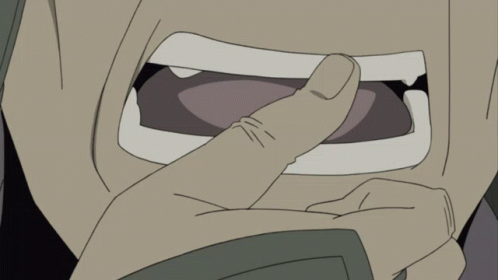

# ▸ Hiruzen



<mark style="color:$success;"><strong>»</strong></mark> <strong>IDENTITÉ</strong> <mark style="color:$success;"><strong>«</strong></mark>

➜ <mark style="color:$success;">**Camp**</mark> • <mark style="color:green;">**Shinobi**</mark>

> Objectif : gagner avec les <mark style="color:green;">**Shinobi**</mark>.

➜ <mark style="color:$success;">**Chakra**</mark> • `Nature`

> une nature aléatoire au début de la partie (voir [Natures de chakra](../../particularites/natures-de-chakra.md)).





<mark style="color:$success;"><strong>»</strong></mark> <strong>COMPÉTENCES</strong> <mark style="color:$success;"><strong>«</strong></mark>

➜ <mark style="color:$success;">**Bâton de Combat**</mark> • `Passif`

> <mark style="color:green;">**Hiruzen**</mark> possède un bâton qui frappe comme une épée en diamant **Tranchant III**. Toutes les **15 secondes**, son prochain coup peut toucher jusqu'à **4 blocs**.
>
> ➜ Si ce coup touche, `Clic-Droit` dans les **10 secondes** le fait bondir de **5 blocs** en arrière.

➜ <mark style="color:$success;">**Volonté du Feu**</mark> • `Passif`

> Quand <mark style="color:green;">**Hiruzen**</mark> descend sous **4**<mark style="color:red;">**❤**</mark>, sa prochaine technique élémentaire est utilisable tout de suite, même en cooldown.
>
> ⚠ Ce passif ne marche pas pour l'Enchaînement. Il se recharge en **4 minutes**.





<mark style="color:$success;"><strong>»</strong></mark> <strong>CAPACITÉS</strong> <mark style="color:$success;"><strong>«</strong></mark>

➜ <mark style="color:$success;">**Maîtrise élémentaire**</mark> • `Clic-Gauche` • ⌚ : 2 minutes

> `Clic-Gauche` : <mark style="color:green;">**Hiruzen**</mark> passe à la nature suivante, toutes les **10 secondes** au plus. Il ne bénéficie que du passif de cette nature.
>
> `Clic-Droit` : il utilise la technique de cette nature.
>
> * **Katon :** un souffle de feu de **12 × 3** inflige **1**<mark style="color:red;">**❤**</mark> et enflamme pendant **3 secondes**.
> * **Suiton :** un jet d'eau part jusqu'à **15 blocs**. Un geyser propulse le premier joueur touché à **30 blocs**, et sa chute ne lui retire que **1**<mark style="color:red;">**❤**</mark>.
> * **Raiton :** un éclair en zigzag jaillit de sa main jusqu'à **15 blocs**, et la foudre tombe sur le premier joueur touché : **1**<mark style="color:red;">**❤**</mark> et <mark style="color:purple;">**Lenteur II**</mark> pendant **3 secondes**.
> * **Fûton :** une tornade avance sur **12 blocs**, soulève les joueurs, les éjecte et inflige **1,5**<mark style="color:red;">**❤**</mark>.
> * **Doton :** un mur de terre de **10 × 4**, épais de **2 blocs**, sort du sol à **4 blocs** devant lui pendant **8 secondes**.

➜ <mark style="color:$success;">**Enchaînement Élémentaire**</mark> • `Clic-Droit` • ⌚ : 4 minutes

> Ce pouvoir partage la Nether Star des Cinq Remparts.
>
> `Clic-Droit` : sans combinaison choisie (ou pendant le cooldown), <mark style="color:green;">**Hiruzen**</mark> choisit **2 natures** dans le menu.
>
> Avec une combinaison choisie, les deux techniques partent en même temps, puis il en choisit une nouvelle.
>
> * **Katon** et **Fûton :** la tornade s'enflamme et enflamme pendant **3 secondes**.
> * **Suiton** et **Katon :** le Suiton projette le joueur dans les airs pendant que le Katon lui inflige **1**<mark style="color:red;">**❤**</mark> et l'enflamme **3 secondes**.
> * **Suiton** puis **Raiton :** la foudre tombe sur le joueur propulsé, jusqu'à **40 blocs**, et l'immobilise **0,5 seconde**.
> * **Doton** puis **Suiton :** le mur éclate, et ses débris touchent les joueurs sur **8 blocs** derrière lui (**1**<mark style="color:red;">**❤**</mark>).

➜ <mark style="color:$success;">**Les Cinq Remparts**</mark> • `Clic-Droit` • ⌚ : 8 minutes

> <mark style="color:green;">**Hiruzen**</mark> fait surgir **5 piliers** en bois au hasard dans un rayon de **30 blocs**, pendant **1 minute**.
>
> En réutilisant le pouvoir, il se téléporte au sommet d'un pilier au hasard, qui s'effondre **2 secondes** après.
>
> ⚠ **2 téléportations** au maximum. Les piliers peuvent être cassés.



***

<figure><figcaption>
Illustration de Hiruzen.
</figcaption></figure>

