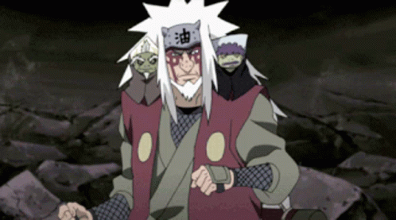

# ▸ Jiraya



<mark style="color:$success;"><strong>»</strong></mark> <strong>IDENTITÉ</strong> <mark style="color:$success;"><strong>«</strong></mark>

➜ <mark style="color:$success;">**Camp**</mark> • <mark style="color:green;">**Shinobi**</mark>

> Objectif : gagner avec les <mark style="color:green;">**Shinobi**</mark>.

➜ <mark style="color:$success;">**Chakra**</mark> • `Nature`

> <mark style="color:red;">**Katon**</mark> et <mark style="color:orange;">**Doton**</mark> (voir [Natures de chakra](../../particularites/natures-de-chakra.md)).





<mark style="color:$success;"><strong>»</strong></mark> <strong>COMPÉTENCES</strong> <mark style="color:$success;"><strong>«</strong></mark>

➜ <mark style="color:$success;">**Hari Jizô**</mark> • `Passif`

> Tous les **20 coups reçus**, <mark style="color:green;">**Jiraya**</mark> esquive un coup d'épée. Les flèches ne lui infligent aucun dégât, mais le repoussent.





<mark style="color:$success;"><strong>»</strong></mark> <strong>CAPACITÉS</strong> <mark style="color:$success;"><strong>«</strong></mark>

➜ <mark style="color:$success;">**Mode Ermite**</mark> • `/ns mode ermite`

> Avec `/ns mode ermite`, <mark style="color:green;">**Jiraya**</mark> **active** ou **désactive** le Mode Ermite. En mode, les cooldowns de ses objets sont **divisés par deux**.
>
> Sa jauge de **150 %** perd **1 %** toutes les **2 secondes** en mode, et regagne **1 %** toutes les **4 secondes** hors mode.

➜ <mark style="color:$success;">**Fukasaku et Shima**</mark> • `/ns color`

> En Mode Ermite, Fukasaku et Shima se posent sur les épaules de <mark style="color:green;">**Jiraya**</mark>. Toutes les **10 secondes**, l'un d'eux utilise une capacité :
>
> * **Fukasaku** fait jaillir un geyser de **5 blocs** sous un joueur (**1,5**<mark style="color:red;">**❤**</mark> et <mark style="color:purple;">**Lenteur I**</mark> pendant **5 secondes**), crache une boule de feu (**1**<mark style="color:red;">**❤**</mark> et feu), ou réduit de **20 %** le cooldown d'un objet de <mark style="color:green;">**Jiraya**</mark>.
> * **Shima** attire le joueur le plus proche avec sa langue, le pousse de **5 blocs** sur le côté, ou lui inflige <mark style="color:violet;">**Cécité**</mark> pendant **5 secondes**.
>
> ⚠ Les joueurs colorés en vert avec `/ns color` ne sont jamais visés.

➜ <mark style="color:$success;">**Rasengan**</mark> • `Clic-Droit` • ⌚ : 5 minutes

> Le prochain coup de <mark style="color:green;">**Jiraya**</mark> inflige **1,5**<mark style="color:red;">**❤**</mark> et crée une explosion.

➜ <mark style="color:$success;">**Kuchiyose**</mark> • `Clic-Droit` • ⌚ : 10 minutes

> <mark style="color:green;">**Jiraya**</mark> monte sur une grenouille de **10**<mark style="color:red;">**❤**</mark>, qui avance à **4 blocs par seconde** là où il regarde.
>
> Sauter déclenche un double saut, et `Clic-Droit` un dash de **4 blocs** toutes les **10 secondes**. La grenouille reste **1 minute**.



***

<figure><figcaption>
Illustration de Jiraya.
</figcaption></figure>

