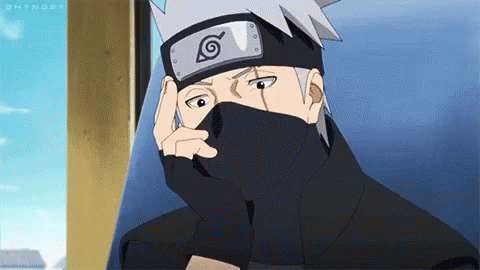

# ▸ Kakashi



<mark style="color:$success;"><strong>»</strong></mark> <strong>IDENTITÉ</strong> <mark style="color:$success;"><strong>«</strong></mark>

➜ <mark style="color:$success;">**Camp**</mark> • <mark style="color:green;">**Shinobi**</mark>

> Objectif : gagner avec les <mark style="color:green;">**Shinobi**</mark>.

➜ <mark style="color:$success;">**Chakra**</mark> • `Nature`

> <mark style="color:yellow;">**Raiton**</mark> et <mark style="color:blue;">**Suiton**</mark> (voir [Natures de chakra](../../particularites/natures-de-chakra.md)).





<mark style="color:$success;"><strong>»</strong></mark> <strong>COMPÉTENCES</strong> <mark style="color:$success;"><strong>«</strong></mark>

➜ <mark style="color:$success;">**Double Mangekyō Sharingan**</mark> • `Particularités`

> À la mort d'[<mark style="color:red;">**Obito**</mark>](../akatsuki/obito.md), une flèche montre son corps à <mark style="color:green;">**Kakashi**</mark>. Il a **5 minutes** pour faire `Clic-Droit` dessus et prendre son Sharingan.
>
> Il débloque alors le Susano pendant **15 minutes**, puis perd les pouvoirs du Sharingan.





<mark style="color:$success;"><strong>»</strong></mark> <strong>CAPACITÉS</strong> <mark style="color:$success;"><strong>«</strong></mark>

➜ <mark style="color:$success;">**Chidori**</mark> • `Clic-Droit` • ⌚ : 5 minutes

> Le prochain coup de <mark style="color:green;">**Kakashi**</mark> inflige **1,5**<mark style="color:red;">**❤**</mark> et immobilise le joueur pendant **0,2 seconde**.

➜ <mark style="color:$success;">**Mangekyō Sharingan**</mark> • `Clic-Gauche` • ⌚ : 5 minutes

> <mark style="color:green;">**Kakashi**</mark> copie chaque pouvoir utilisé par les autres joueurs.
>
> `Clic-Gauche` : il choisit un pouvoir copié dans le menu.
>
> `Clic-Droit` : il utilise ce pouvoir.

➜ <mark style="color:$success;">**Kamui**</mark> • `Clic-Gauche` • ⌚ : 10 minutes

> `Clic-Gauche` : <mark style="color:green;">**Kakashi**</mark> entre dans Kamui, ou en sort, quand il veut et sans cooldown, sauf en combat.
>
> `Clic-Droit` : il envoie dans Kamui le joueur visé à moins de **30 blocs** pendant **5 minutes**, ou le fait sortir. Chacun ressort là où il est entré.

➜ <mark style="color:$success;">**Susano**</mark> • `Clic-Droit` • ⏳ : 2 minutes • ⌚ : 10 minutes

> <mark style="color:green;">**Kakashi**</mark> s'entoure du Susano : <mark style="color:blue;">**Résistance I**</mark> et **20 %** de chances d'esquiver chaque coup d'épée reçu.
>
> ➜ <mark style="color:$success;">**Shurikens**</mark> • `Clic-Droit` • ⌚ : 30 secondes
>
> > <mark style="color:green;">**Kakashi**</mark> lance un shuriken qu'il dirige avec son curseur pendant son déplacement. À l'impact, il explose et inflige **2**<mark style="color:red;">**❤**</mark>.
>
> ➜ <mark style="color:$success;">**Zone**</mark> • `Clic-Gauche` • ⌚ : 15 secondes
>
> > <mark style="color:green;">**Kakashi**</mark> vise un bloc jusqu'à **30 blocs**. Les blocs dans un cube de **5 × 5 × 5** autour de ce bloc sont détruits.



***

<figure><figcaption>
Illustration de Kakashi.
</figcaption></figure>

