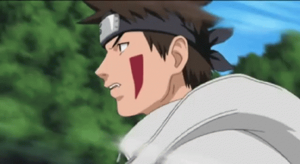

# ▸ Kiba



<mark style="color:$success;"><strong>»</strong></mark> <strong>IDENTITÉ</strong> <mark style="color:$success;"><strong>«</strong></mark>

➜ <mark style="color:$success;">**Camp**</mark> • <mark style="color:green;">**Shinobi**</mark>

> Objectif : gagner avec les <mark style="color:green;">**Shinobi**</mark>.

➜ <mark style="color:$success;">**Chakra**</mark> • `Nature`

> <mark style="color:orange;">**Doton**</mark> (voir [Natures de chakra](../../particularites/natures-de-chakra.md)).





<mark style="color:$success;"><strong>»</strong></mark> <strong>COMPÉTENCES</strong> <mark style="color:$success;"><strong>«</strong></mark>

➜ <mark style="color:$success;">**Détection de chakra**</mark> • `/ns chakra <joueur>`

> Avec `/ns chakra <joueur>`, <mark style="color:green;">**Kiba**</mark> sent le chakra d'un joueur et découvre sa **catégorie de chakra**. Elle ne donne **ni le rôle, ni le camp**.
>
> <mark style="color:green;">**Chakra apaisé**</mark> : principalement des Shinobi, mais certains ennemis peuvent aussi en faire partie.
>
> <mark style="color:yellow;">**Chakra trouble**</mark> : un mélange de Shinobi et d'ennemis. Cette information ne suffit pas pour faire confiance au joueur.
>
> <mark style="color:orange;">**Chakra sombre**</mark> : principalement des ennemis, avec quelques Shinobi.
>
> <mark style="color:red;">**Chakra malveillant**</mark> : uniquement des ennemis. Le joueur n'appartient pas au camp Shinobi.
>
> Chaque rôle a toujours la même catégorie. `/ns chakra` seul affiche les quatre catégories.
>
> <mark style="color:red;">⚠ Ces catégories n'ont rien à voir avec les </mark><mark style="color:red;">**natures de chakra**</mark><mark style="color:red;"> (Katon, Suiton…).</mark>

➜ <mark style="color:$success;">**Griffes**</mark> • `Particularités`

> <mark style="color:green;">**Kiba**</mark> se bat à mains nues. Ses griffes frappent comme une **épée en diamant Tranchant III**, ou **Tranchant IV** quand Akamaru est sorti.





<mark style="color:$success;"><strong>»</strong></mark> <strong>CAPACITÉS</strong> <mark style="color:$success;"><strong>«</strong></mark>

➜ <mark style="color:$success;">**Akamaru**</mark> • `Clic-Droit`

> Akamaru possède **50**<mark style="color:red;">**❤**</mark> et <mark style="color:cyan;">**Vitesse II**</mark>. Il attaque les joueurs que <mark style="color:green;">**Kiba**</mark> a frappés, ou qui l'ont frappé, dans les **20 dernières secondes**.
>
> `Clic-Droit` : <mark style="color:green;">**Kiba**</mark> monte sur Akamaru (sur l'objet ou sur Akamaru) et peut sauter de **3 blocs** de haut.
>
> `Clic-Gauche` : hors combat, <mark style="color:green;">**Kiba**</mark> range ou sort Akamaru, qui garde ses cœurs.
>
> <mark style="color:red;">⚠ S'il est touché pendant que </mark><mark style="color:red;">**Kiba**</mark><mark style="color:red;"> le monte, Akamaru est ralenti de </mark><mark style="color:red;">**50 %**</mark><mark style="color:red;"> pendant </mark><mark style="color:red;">**5 secondes**</mark><mark style="color:red;">. S'il meurt, il revient après </mark><mark style="color:red;">**5 minutes**</mark><mark style="color:red;">.</mark>

➜ <mark style="color:$success;">**Fusion avec Akamaru**</mark> • `Clic-Droit` • ⏳ : 2 minutes • ⌚ : 10 minutes

> <mark style="color:green;">**Kiba**</mark> fusionne avec Akamaru, qui doit être en vie, et prend l'apparence d'un chien.
>
> * Toutes les **10 secondes**, un de ses coups peut toucher jusqu'à **4 blocs**.
> * Tous les **15 coups**, il inflige un saignement de **½**<mark style="color:red;">**❤**</mark> pendant **3 secondes**.
> * Double saut : un dash de **10 blocs**, toutes les **30 secondes**.
>
> <mark style="color:red;">⚠ </mark><mark style="color:red;">**Pendant la fusion, ses griffes restent à Tranchant III.**</mark>



***

<figure><figcaption>
Illustration de Kiba.
</figcaption></figure>

