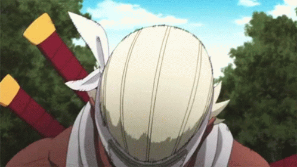

# ▸ Killer Bee



<mark style="color:$success;"><strong>»</strong></mark> <strong>IDENTITÉ</strong> <mark style="color:$success;"><strong>«</strong></mark>

➜ <mark style="color:$success;">**Camp**</mark> • <mark style="color:green;">**Shinobi**</mark>

> Objectif : gagner avec les <mark style="color:green;">**Shinobi**</mark>.

➜ <mark style="color:$success;">**Chakra**</mark> • `Nature`

> <mark style="color:yellow;">**Raiton**</mark> (voir [Natures de chakra](../../particularites/natures-de-chakra.md)).





<mark style="color:$success;"><strong>»</strong></mark> <strong>COMPÉTENCES</strong> <mark style="color:$success;"><strong>«</strong></mark>

➜ <mark style="color:$success;">**Immunité**</mark> • `Passif`

> <mark style="color:green;">**Killer Bee**</mark> est immunisé contre les effets négatifs : <mark style="color:green;">**Poison**</mark>, <mark style="color:purple;">**Lenteur**</mark>, <mark style="color:violet;">**Cécité**</mark>…

➜ <mark style="color:$success;">**Les Sept Épées**</mark> • `Passif`

> <mark style="color:green;">**Killer Bee**</mark> possède **7 épées en fer Tranchant IV**, regroupées dans le premier emplacement. Il commence avec **1** seule lame.
>
> Chaque lame en plus lui donne **+4 %** de <mark style="color:red;">Force</mark>, soit **+24 %** avec les sept.
>
> `/ns add lame <nombre>` et `/ns remove lame <nombre>` ajoutent ou retirent des lames.





<mark style="color:$success;"><strong>»</strong></mark> <strong>CAPACITÉS</strong> <mark style="color:$success;"><strong>«</strong></mark>

➜ <mark style="color:$success;">**Tentacules**</mark> • `Clic-Droit` • ⌚ : 5 minutes

> <mark style="color:green;">**Killer Bee**</mark> saisit le joueur visé pendant **15 secondes** et le tient à **3 blocs** devant lui. Le joueur suit son regard et subit **½**<mark style="color:red;">**❤**</mark> toutes les **5 secondes**.
>
> * Molette vers le haut ou vers le bas : il l'éloigne (jusqu'à **60 blocs**) ou le rapproche.
> * `Clic-Droit` : il le relâche.
> * `Clic-Gauche` : il le projette au loin.

➜ <mark style="color:$success;">**Manteau de Chakra**</mark> • `Clic-Droit`

> <mark style="color:green;">**Killer Bee**</mark> **active** ou **désactive** un manteau rouge qui le protège de tous les projectiles et des pouvoirs du Sharingan.
>
> Chacun de ses coups a **10 %** de chances de le téléporter derrière le joueur frappé.
>
> Sa jauge de chakra de **100** perd **2** points par seconde quand le manteau est actif, et en regagne **2** toutes les **6 secondes**.



***

<figure><figcaption>
Illustration de Killer Bee.
</figcaption></figure>

