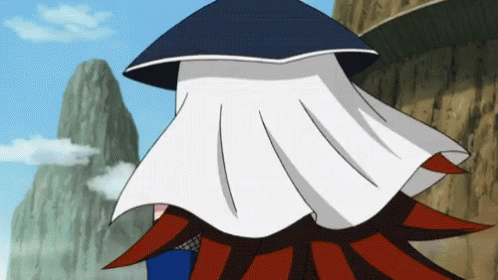

# ▸ Mei



<mark style="color:$success;"><strong>»</strong></mark> <strong>IDENTITÉ</strong> <mark style="color:$success;"><strong>«</strong></mark>

➜ <mark style="color:$success;">**Camp**</mark> • <mark style="color:green;">**Shinobi**</mark>

> Objectif : gagner avec les <mark style="color:green;">**Shinobi**</mark>.

➜ <mark style="color:$success;">**Chakra**</mark> • `Nature`

> <mark style="color:blue;">**Suiton**</mark> et <mark style="color:red;">**Katon**</mark> (voir [Natures de chakra](../../particularites/natures-de-chakra.md)).





<mark style="color:$success;"><strong>»</strong></mark> <strong>COMPÉTENCES</strong> <mark style="color:$success;"><strong>«</strong></mark>

➜ <mark style="color:$success;">**Effet**</mark> • `Passif`

> <mark style="color:green;">**Mei**</mark> possède l'effet <mark style="color:orange;">**Résistance au feu**</mark> permanent.

➜ <mark style="color:$success;">**Maîtrise de l'Acidité**</mark> • `Passif`

> Tous les **15 coups**, <mark style="color:green;">**Mei**</mark> couvre son adversaire d'acide pendant **4 secondes**. Sa prochaine pomme d'or ne lui donne alors que **1**<mark style="color:red;">**❤**</mark> d'<mark style="color:yellow;">absorption</mark>.
>
> <mark style="color:red;">⚠ L'effet ne se cumule pas.</mark>





<mark style="color:$success;"><strong>»</strong></mark> <strong>CAPACITÉS</strong> <mark style="color:$success;"><strong>«</strong></mark>

➜ <mark style="color:$success;">**Yōton — Boule de Lave**</mark> • `Clic-Droit` • ⌚ : 5 minutes

> <mark style="color:green;">**Mei**</mark> crache une boule de lave jusqu'à **20 blocs**. À l'impact, elle inflige **1,5**<mark style="color:red;">**❤**</mark> dans un rayon de **3 blocs**.
>
> Une flaque de lave de **5 × 5** reste **8 secondes** et enflamme ceux qui la traversent pendant **3 secondes**.

➜ <mark style="color:$success;">**Futton — Brume Acide**</mark> • `/ns color` • ⌚ : 8 minutes

> <mark style="color:green;">**Mei**</mark> crée une brume de **15 blocs** pendant **30 secondes**. Les joueurs à l'intérieur subissent <mark style="color:violet;">**Cécité**</mark>.
>
> <mark style="color:green;">**Mei**</mark> voit leur corrosion, qui monte de **5 %** par seconde dans la brume et descend de **10 %** par seconde dehors.
>
> À **100 %**, le joueur subit **1,5**<mark style="color:red;">**❤**</mark> et le compteur revient à 0 %.
>
> <mark style="color:red;">⚠ Les joueurs colorés en vert avec </mark>`/ns color`<mark style="color:red;"> ne sont pas touchés.</mark>

➜ <mark style="color:$success;">**Mur de Lave**</mark> • `Clic-Droit` • ⌚ : 5 minutes

> <mark style="color:green;">**Mei**</mark> crée un mur de lave de **10 × 4** jusqu'à **8 blocs** devant elle, pendant **10 secondes**.
>
> Un adversaire qui le touche subit **½**<mark style="color:red;">**❤**</mark> et recule de **3 blocs**, au plus une fois toutes les **2 secondes**. Réutiliser le pouvoir retire le mur.

➜ <mark style="color:$success;">**Suiton — Dragon Aqueux**</mark> • `Clic-Droit` • ⌚ : 5 minutes

> <mark style="color:green;">**Mei**</mark> lance un dragon d'eau sur **25 blocs**. Le premier joueur touché est emporté sur **8 blocs** et subit **1,5**<mark style="color:red;">**❤**</mark>.
>
> Si le dragon traverse la Brume Acide, le joueur reçoit aussi **30 %** de corrosion.



***

<figure><figcaption>
Illustration de Mei.
</figcaption></figure>

