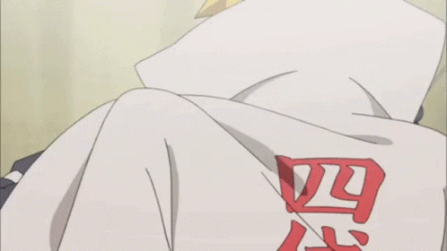

# ▸ Minato



<mark style="color:$success;"><strong>»</strong></mark> <strong>IDENTITÉ</strong> <mark style="color:$success;"><strong>«</strong></mark>

➜ <mark style="color:$success;">**Camp**</mark> • <mark style="color:green;">**Shinobi**</mark>

> Objectif : gagner avec les <mark style="color:green;">**Shinobi**</mark>.

➜ <mark style="color:$success;">**Chakra**</mark> • `Nature`

> <mark style="color:green;">**Fûton**</mark> (voir [Natures de chakra](../../particularites/natures-de-chakra.md)).





<mark style="color:$success;"><strong>»</strong></mark> <strong>CAPACITÉS</strong> <mark style="color:$success;"><strong>«</strong></mark>

➜ <mark style="color:$success;">**Rasengan**</mark> • `Clic-Droit` • ⌚ : 5 minutes

> Le prochain coup de <mark style="color:green;">**Minato**</mark> inflige **1,5**<mark style="color:red;">**❤**</mark> et crée une explosion.

➜ <mark style="color:$success;">**Shurikenjutsu**</mark> • `Clic-Gauche` • ⌚ : 3 minutes

> <mark style="color:green;">**Minato**</mark> possède un arc. Une flèche plantée dans un bloc ou dans un joueur devient un point de téléportation.
>
> * `Clic-Gauche` avec l'arc : il se téléporte à sa dernière flèche plantée dans un bloc.
> * Un joueur touché garde un **sceau** au-dessus de son pseudo jusqu'à la fin de la partie : `Clic-Gauche` en le visant téléporte <mark style="color:green;">**Minato**</mark> sur lui.

➜ <mark style="color:$success;">**Mode Ermite**</mark> • `/ns mode ermite`

> `/ns mode ermite` **active** ou **désactive** le Mode Ermite. En mode, les cooldowns de ses objets sont **divisés par deux**.
>
> Sa jauge de **100 %** perd **1 %** toutes les **2 secondes** en mode, et regagne **1 %** toutes les **5 secondes** hors mode.

➜ <mark style="color:$success;">**Mode Kurama**</mark> • `Clic-Droit` • ⏳ : 2 minutes • ⌚ : 15 minutes

> <mark style="color:green;">**Minato**</mark> obtient <mark style="color:cyan;">**Vitesse I**</mark> et une surbrillance jaune, et ses cooldowns sont **divisés par deux**. Son Rasengan inflige **2,5**<mark style="color:red;">**❤**</mark> et projette le joueur à **15 blocs**.
>
> `Clic-Droit` : il attire le joueur visé.
>
> `Clic-Gauche` : il projette le joueur visé au loin.
>
> ➜ Ces deux actions se rechargent en **20 secondes**.



***

<figure><figcaption>
Illustration de Minato.
</figcaption></figure>

