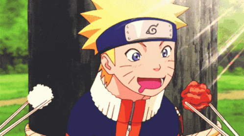

# ▸ Naruto



<mark style="color:$success;"><strong>»</strong></mark> <strong>IDENTITÉ</strong> <mark style="color:$success;"><strong>«</strong></mark>

➜ <mark style="color:$success;">**Camp**</mark> • <mark style="color:green;">**Shinobi**</mark>

> Objectif : gagner avec les <mark style="color:green;">**Shinobi**</mark>.

➜ <mark style="color:$success;">**Chakra**</mark> • `Nature`

> <mark style="color:green;">**Fûton**</mark> (voir [Natures de chakra](../../particularites/natures-de-chakra.md)).





<mark style="color:$success;"><strong>»</strong></mark> <strong>CAPACITÉS</strong> <mark style="color:$success;"><strong>«</strong></mark>

➜ <mark style="color:$success;">**Multi-clonage**</mark> • `/ns clone <nombre>`

> `/ns clone <nombre>` : <mark style="color:green;">**Naruto**</mark> invoque **1 à 3 clones**. Chaque clone a **10**<mark style="color:red;">**❤**</mark> et frappe comme une épée en diamant **Tranchant III**, toutes les **2 secondes**.
>
> <mark style="color:red;">⚠ Chaque clone ajoute </mark><mark style="color:red;">**5 minutes**</mark><mark style="color:red;"> au cooldown : </mark><mark style="color:red;">**15 minutes**</mark><mark style="color:red;"> pour trois clones.</mark>

➜ <mark style="color:$success;">**Rasengan**</mark> • `Clic-Droit` • ⌚ : 5 minutes

> Le prochain coup de <mark style="color:green;">**Naruto**</mark> inflige **1,5**<mark style="color:red;">**❤**</mark> et crée une explosion.

➜ <mark style="color:$success;">**Rasenshuriken**</mark> • `Clic-Droit` • ⌚ : 15 minutes

> Deux clones aident <mark style="color:green;">**Naruto**</mark> à former l'orbe pendant **5 secondes**, sans bouger. L'orbe part ensuite vers le joueur visé, jusqu'à **30 blocs**.
>
> À l'impact, elle détruit les blocs, attire les joueurs touchés et leur inflige **2,5**<mark style="color:red;">**❤**</mark>.
>
> <mark style="color:red;">⚠ Le multi-clonage doit être disponible. Bouger pendant la formation annule le pouvoir.</mark>

➜ <mark style="color:$success;">**Mode Ermite — Mont Myôboku**</mark> • `/ns mode ermite`

> **Accès**
>
> À partir de **60 minutes** de jeu, `/ns mode ermite` envoie <mark style="color:green;">**Naruto**</mark> au **Mont Myôboku**. De petites particules vertes le guident.
>
> **Épreuves**
>
> * Monter la **spirale de pierres**. Une chute le ramène au point d'arrivée.
> * Vaincre **trois vagues de grenouilles** dans la clairière : **2**, **3** puis **4**.
> * Méditer **10 secondes** sur le **sceau d'or** du bassin d'huile.
>
> <mark style="color:red;">⚠ S'il quitte le mont pendant les vagues, la clairière recommence à la prochaine visite.</mark>
>
> **Mode Ermite**
>
> Une fois le mode obtenu, la même commande l'**active** ou le **désactive**.
>
> * Jauge de **100 %** : **−1 %** toutes les **2 secondes** en mode, **+1 %** toutes les **5 secondes** hors mode.
> * Cooldown du Rasenshuriken : **10 minutes**.
> * Cooldown du multi-clonage : **2 min 30 s** par clone.

➜ <mark style="color:$success;">**Kyûbi — Dompter Kurama**</mark> • `/ns kurama`

> **Kurama**
>
> * Commence la partie avec **2 500**<mark style="color:red;">**❤**</mark> et <mark style="color:red;">**Force I**</mark>.
> * Perd **10**<mark style="color:red;">**❤**</mark> toutes les **30 secondes**.
> * Perd **2**<mark style="color:red;">**❤**</mark> à chaque coup d'épée reçu par <mark style="color:green;">**Naruto**</mark>.
> * Sa vie reste affichée dans la barre d'action de <mark style="color:green;">**Naruto**</mark> pendant toute la partie.
>
> **Activation**
>
> Avec `/ns kurama`, <mark style="color:green;">**Naruto**</mark> entre dans son monde intérieur, devant la cage de Kurama.
>
> Kurama apparaît devant lui : un **cube de magma géant**, avec la vie qu'il lui reste. Le combat se joue en **1 contre 1**.
>
> Pendant ce temps, le corps de <mark style="color:green;">**Naruto**</mark> reste sur place en surbrillance rouge, et un cri retentit sur toute la carte.
>
> **Pendant le combat**
>
> * Au contact, Kurama inflige **3**<mark style="color:red;">**❤**</mark>.
> * Toutes les **8 secondes**, il lance une attaque au hasard :
>   * **Orbe des Démons** : une boule qui explose, **3**<mark style="color:red;">**❤**</mark> et recul.
>   * **Souffle de feu** : **½**<mark style="color:red;">**❤**</mark> et feu toutes les demi-secondes dans le cône.
>   * **Coup de queues** : **2**<mark style="color:red;">**❤**</mark> et projection.
>
> **Victoire**
>
> Si la vie de Kurama tombe à **0**, il est dompté : <mark style="color:green;">**Naruto**</mark> obtient le **Mode Kurama**.
>
> **Défaite**
>
> Si <mark style="color:green;">**Naruto**</mark> descend à **2**<mark style="color:red;">**❤**</mark>, il perd le combat :
>
> * Kurama contrôle son corps pendant **5 minutes**. Il poursuit les joueurs qu'il voit et les frappe comme une épée en diamant **Tranchant III** (leur armure compte). S'il ne voit personne, il marche tranquillement.
> * <mark style="color:green;">**Naruto**</mark> regarde son corps en spectateur invisible : il vole, mais ne peut ni frapper, ni être frappé, ni utiliser ses pouvoirs, et ne peut pas s'éloigner à plus de **30 blocs** de son corps.
> * Si ce corps est tué, <mark style="color:green;">**Naruto**</mark> meurt.

➜ <mark style="color:$success;">**Mode Kurama**</mark> • `Clic-Droit` • ⏳ : 2 minutes • ⌚ : 15 minutes

> <mark style="color:green;">**Naruto**</mark> obtient <mark style="color:red;">**Force I**</mark> et une surbrillance jaune.
>
> * Ses clones passent à **15**<mark style="color:red;">**❤**</mark> et frappent comme une épée **Tranchant IV**.
> * Le Rasenshuriken devient l'**Orbe des Démons à Queues**.
>
> **Orbe des Démons à Queues**
>
> * Plus besoin de clones, mais toujours **5 secondes** de formation.
> * L'orbe creuse un cratère de **50 blocs**, inflige **4**<mark style="color:red;">**❤**</mark> et enflamme pendant **5 secondes**.
> * Cooldown : **15 minutes**.
>
> <mark style="color:red;">⚠ Après le mode, le Rasenshuriken attend la fin du cooldown de l'orbe.</mark>



***

<figure><figcaption>
Illustration de Naruto.
</figcaption></figure>

