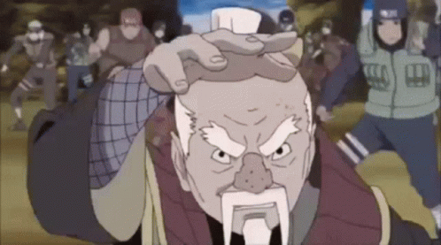

# ▸ Ônoki



<mark style="color:$success;"><strong>»</strong></mark> <strong>IDENTITÉ</strong> <mark style="color:$success;"><strong>«</strong></mark>

➜ <mark style="color:$success;">**Camp**</mark> • <mark style="color:green;">**Shinobi**</mark>

> Objectif : gagner avec les <mark style="color:green;">**Shinobi**</mark>.

➜ <mark style="color:$success;">**Chakra**</mark> • `Nature`

> <mark style="color:orange;">**Doton**</mark> et <mark style="color:green;">**Fûton**</mark> (voir [Natures de chakra](../../particularites/natures-de-chakra.md)).





<mark style="color:$success;"><strong>»</strong></mark> <strong>COMPÉTENCES</strong> <mark style="color:$success;"><strong>«</strong></mark>

➜ <mark style="color:$success;">**Effet**</mark> • `Passif`

> <mark style="color:green;">**Ônoki**</mark> subit **50 %** de dégâts de chute en moins.

➜ <mark style="color:$success;">**Poing de Pierre**</mark> • `Passif`

> Tous les **15 coups**, le prochain coup d'<mark style="color:green;">**Ônoki**</mark> inflige **½**<mark style="color:red;">**❤**</mark> de plus et projette le joueur à **5 blocs**, ou à **3 blocs** de haut s'il est alourdi.





<mark style="color:$success;"><strong>»</strong></mark> <strong>CAPACITÉS</strong> <mark style="color:$success;"><strong>«</strong></mark>

➜ <mark style="color:$success;">**Étoile « Doton »**</mark> • `Clic-Gauche` / `Clic-Droit`

> Ces pouvoirs sont réunis sur une Nether Star : **Doton**, **Doton**, **Golem de Pierre**, **Jinton**, **Élévation du Terrain**.
>
> * `Clic-Gauche` : passer au pouvoir suivant.
> * `Clic-Droit` : utiliser le pouvoir sélectionné.

➜ <mark style="color:$success;">**Doton — Allègement**</mark> • `Clic-Droit` • Étoile « Doton » • ⌚ : 5 minutes

> Pendant **30 secondes**, <mark style="color:green;">**Ônoki**</mark> peut faire un double saut de **5 blocs**, toutes les **5 secondes**. Accroupi en l'air, il plane jusqu'au sol.

➜ <mark style="color:$success;">**Doton — Alourdissement**</mark> • `Clic-Droit` • Étoile « Doton » • ⌚ : 5 minutes

> Le prochain coup d'<mark style="color:green;">**Ônoki**</mark> alourdit le joueur pendant **5 secondes** : il ne peut plus sauter et subit **50 %** de recul en moins.

➜ <mark style="color:$success;">**Golem de Pierre**</mark> • `Clic-Droit` • Étoile « Doton » • ⌚ : 8 minutes

> <mark style="color:green;">**Ônoki**</mark> invoque un golem de **20**<mark style="color:red;">**❤**</mark> pendant **30 secondes**. Le golem poursuit le dernier joueur frappé et le tape toutes les **3 secondes** : **½**<mark style="color:red;">**❤**</mark> et **3 blocs** de recul.
>
> ➜ Réutiliser l'objet : le golem se change en mur de **5 × 4** pendant **8 secondes**.

➜ <mark style="color:$success;">**Jinton — Détachement du Monde Primitif**</mark> • `Clic-Droit` • Étoile « Doton » • ⌚ : 10 minutes

> <mark style="color:green;">**Ônoki**</mark> charge un cube pendant **3 secondes** sans bouger, puis le lance vers le point visé, jusqu'à **25 blocs**.
>
> Le cube s'ouvre en une zone de **7 × 7 × 7** : **1 seconde** après, tout y est détruit, et les joueurs encore dedans subissent **3**<mark style="color:red;">**❤**</mark>.
>
> <mark style="color:red;">⚠ S'il bouge pendant la charge, la technique est annulée et le cooldown est rendu.</mark>

➜ <mark style="color:$success;">**Élévation du Terrain**</mark> • `Clic-Droit` • Étoile « Doton » • ⌚ : 5 minutes

> <mark style="color:green;">**Ônoki**</mark> soulève une plateforme de **20 × 20** sous lui à **20 blocs** de haut, avec les joueurs qui s'y trouvent, pendant **15 secondes**. Réutiliser le pouvoir la fait redescendre.



***

<figure><figcaption>
Illustration de Ônoki.
</figcaption></figure>

