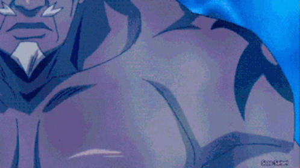

# ▸ Quatrième Raikage



<mark style="color:$success;"><strong>»</strong></mark> <strong>IDENTITÉ</strong> <mark style="color:$success;"><strong>«</strong></mark>

➜ <mark style="color:$success;">**Camp**</mark> • <mark style="color:green;">**Shinobi**</mark>

> Objectif : gagner avec les <mark style="color:green;">**Shinobi**</mark>.

➜ <mark style="color:$success;">**Chakra**</mark> • `Nature`

> <mark style="color:yellow;">**Raiton**</mark> (voir [Natures de chakra](../../particularites/natures-de-chakra.md)).





<mark style="color:$success;"><strong>»</strong></mark> <strong>COMPÉTENCES</strong> <mark style="color:$success;"><strong>«</strong></mark>

➜ <mark style="color:$success;">**Effet**</mark> • `Passif`

> Le <mark style="color:green;">**Quatrième Raikage**</mark> possède <mark style="color:cyan;">**Vitesse I**</mark>.





<mark style="color:$success;"><strong>»</strong></mark> <strong>CAPACITÉS</strong> <mark style="color:$success;"><strong>«</strong></mark>

➜ <mark style="color:$success;">**Armure Raiton**</mark> • `Clic-Droit` • ⌚ : 10 minutes

> Pendant **1 minute**, le <mark style="color:green;">**Quatrième Raikage**</mark> s'entoure d'éclairs :
>
> * sa <mark style="color:cyan;">Vitesse</mark> monte de **2 %** par seconde jusqu'à **40 %**, retombe à **20 %**, puis remonte ;
> * tous les **10 coups reçus**, une décharge repousse l'attaquant de **4 blocs** ;
> * les flèches lui infligent **50 %** de dégâts en moins.

➜ <mark style="color:$success;">**Lariat**</mark> • `Clic-Droit` • ⌚ : 5 minutes

> Le <mark style="color:green;">**Quatrième Raikage**</mark> charge droit devant lui sur **12 blocs**. Le premier joueur touché subit **2**<mark style="color:red;">**❤**</mark> et il est projeté à **10 blocs**, en cassant les blocs sur son passage.
>
> Pendant l'Armure Raiton, la charge continue à travers ce joueur, et les autres joueurs sur le trajet subissent **1**<mark style="color:red;">**❤**</mark>.

➜ <mark style="color:$success;">**Liger Bomb**</mark> • `Clic-Droit` • ⌚ : 8 minutes

> Le prochain coup du <mark style="color:green;">**Quatrième Raikage**</mark> soulève le joueur de **4 blocs** et l'écrase au sol.
>
> Un cratère de **5 × 5** se forme : le joueur subit **1,5**<mark style="color:red;">**❤**</mark> et ne peut plus sauter pendant **1 seconde**.

➜ <mark style="color:$success;">**Guillotine Drop**</mark> • `Clic-Droit` • ⌚ : 5 minutes

> Le <mark style="color:green;">**Quatrième Raikage**</mark> bondit à **11 blocs** de haut, puis avance lentement là où il regarde, sur **20 blocs** au plus.
>
> Réutiliser le pouvoir le fait retomber d'un coup de talon ; sinon, il retombe au bout des 20 blocs.
>
> À l'impact, les joueurs dans un rayon de **3 blocs** subissent **1,5**<mark style="color:red;">**❤**</mark> et reculent de **6 blocs**.



***

<figure><figcaption>
Illustration de Quatrième Raikage.
</figcaption></figure>

