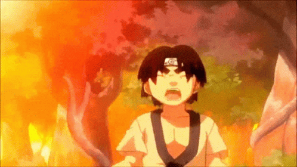

# ▸ Rock Lee



<mark style="color:$success;"><strong>»</strong></mark> <strong>IDENTITÉ</strong> <mark style="color:$success;"><strong>«</strong></mark>

➜ <mark style="color:$success;">**Camp**</mark> • <mark style="color:green;">**Shinobi**</mark>

> Objectif : gagner avec les <mark style="color:green;">**Shinobi**</mark>.

➜ <mark style="color:$success;">**Chakra**</mark> • `Nature`

> une nature aléatoire (voir [Natures de chakra](../../particularites/natures-de-chakra.md)).





<mark style="color:$success;"><strong>»</strong></mark> <strong>CAPACITÉS</strong> <mark style="color:$success;"><strong>«</strong></mark>

➜ <mark style="color:$success;">**Enchaînement**</mark> • `Clic-Droit` • ⌚ : 5 minutes

> Le prochain coup de <mark style="color:green;">**Rock Lee**</mark> soulève le joueur de **3 blocs**, puis l'éjecte à **10 blocs**. <mark style="color:green;">**Rock Lee**</mark> réapparaît devant lui et le renvoie à son point de départ. Le tout inflige **2**<mark style="color:red;">**❤**</mark>.

➜ <mark style="color:$success;">**Fleur de Lotus Recto — Omote Renge**</mark> • `Clic-Droit` • ⌚ : 8 minutes

> `Clic-Droit`, puis frapper un joueur à moins de **3 blocs** : <mark style="color:green;">**Rock Lee**</mark> monte avec lui à **10 blocs**, le joueur est immobilisé **1 seconde**, puis ils plongent ensemble vers le sol.
>
> À l'impact, le joueur subit **2,5**<mark style="color:red;">**❤**</mark>, <mark style="color:purple;">**Lenteur II**</mark>, <mark style="color:green;">**Nausée**</mark> et <mark style="color:violet;">**Cécité**</mark> pendant **2 secondes**.

➜ <mark style="color:$success;">**Les Portes**</mark> • `Clic-Droit`

> <mark style="color:green;">**Rock Lee**</mark> ouvre les Portes avec son objet.
>
> <mark style="color:red;">⚠ Une seule Porte peut être ouverte à la fois. Chaque Porte garde son propre cooldown.</mark>
>
> **Troisième Porte** • ⏳ 1 min 30 s • ⌚ 8 minutes
>
> * **2**<mark style="color:red;">**❤**</mark> d'<mark style="color:yellow;">absorption</mark>, rendus **15 secondes** après les avoir perdus.
> * **+2 %** de <mark style="color:cyan;">Vitesse</mark> par seconde, jusqu'à **20 %**.
>
> <mark style="color:red;">⚠ Une pomme d'or ne monte pas l'absorption au-delà de </mark><mark style="color:red;">**2**</mark><mark style="color:red;">**❤**</mark><mark style="color:red;">. Le bonus de Vitesse retombe à </mark><mark style="color:red;">**0 %**</mark><mark style="color:red;"> à chaque coup reçu.</mark>
>
> **Sixième Porte** • ⏳ 1 minute • ⌚ 12 minutes
>
> * Les effets de la Troisième Porte.
> * Tous les **10 coups** : un coup **×1,2** en **no hit delay**, avec **5 %** de chances d'enflammer.
> * Quand il est frappé : **5 %** de chances de se téléporter dans le dos de l'attaquant.



***

<figure><figcaption>
Illustration de Rock Lee.
</figcaption></figure>

