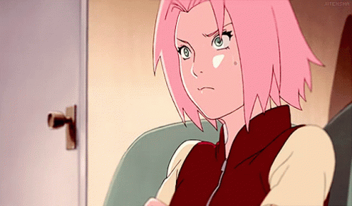

# ▸ Sakura



<mark style="color:$success;"><strong>»</strong></mark> <strong>IDENTITÉ</strong> <mark style="color:$success;"><strong>«</strong></mark>

➜ <mark style="color:$success;">**Camp**</mark> • <mark style="color:green;">**Shinobi**</mark>

> Objectif : gagner avec les <mark style="color:green;">**Shinobi**</mark>.

➜ <mark style="color:$success;">**Chakra**</mark> • `Nature`

> une nature aléatoire (voir [Natures de chakra](../../particularites/natures-de-chakra.md)).





<mark style="color:$success;"><strong>»</strong></mark> <strong>COMPÉTENCES</strong> <mark style="color:$success;"><strong>«</strong></mark>

➜ <mark style="color:$success;">**Force surhumaine**</mark> • `Passif`

> Tous les **15 coups**, le prochain coup de <mark style="color:green;">**Sakura**</mark> devient un smash : le joueur subit **1,5**<mark style="color:red;">**❤**</mark> et il est projeté à **15 blocs**, en cassant les blocs sur son passage.

➜ <mark style="color:$success;">**Soin médical**</mark> • `Passif`

> Chaque pomme d'or de <mark style="color:green;">**Sakura**</mark> a **1 chance sur 10** d'être mangée instantanément.





<mark style="color:$success;"><strong>»</strong></mark> <strong>CAPACITÉS</strong> <mark style="color:$success;"><strong>«</strong></mark>

➜ <mark style="color:$success;">**Katsuyu**</mark> • `Clic-Droit` • ⌚ : 10 minutes

> Katsuyu se pose sur l'épaule de <mark style="color:green;">**Sakura**</mark> pendant **2 minutes**. Toutes les **20 secondes**, elle agit :
>
> * **Soin :** <mark style="color:pink;">**Régénération II**</mark> pendant **6 secondes** pour les alliés colorés en vert avec `/ns color`, à moins de **20 blocs**.
> * **Acide :** le dernier joueur frappé par <mark style="color:green;">**Sakura**</mark> brille en vert et subit **1**<mark style="color:red;">**❤**</mark>, puis **½**<mark style="color:red;">**❤**</mark> toutes les **2 secondes** pendant **4 secondes**.

➜ <mark style="color:$success;">**Impact**</mark> • `Clic-Droit` • ⌚ : 5 minutes

> <mark style="color:green;">**Sakura**</mark> fonce sur **20 blocs** devant elle et frappe le sol à l'arrivée : un cratère de **5 × 5** se forme. Les joueurs pris dedans subissent **2**<mark style="color:red;">**❤**</mark> et sont projetés à **10 blocs**.



***

<figure><figcaption>
Illustration de Sakura.
</figcaption></figure>

