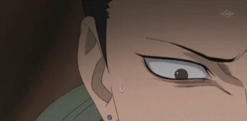

# ▸ Shikamaru



<mark style="color:$success;"><strong>»</strong></mark> <strong>IDENTITÉ</strong> <mark style="color:$success;"><strong>«</strong></mark>

➜ <mark style="color:$success;">**Camp**</mark> • <mark style="color:green;">**Shinobi**</mark>

> Objectif : gagner avec les <mark style="color:green;">**Shinobi**</mark>.

➜ <mark style="color:$success;">**Chakra**</mark> • `Nature`

> une nature aléatoire (voir [Natures de chakra](../../particularites/natures-de-chakra.md)).





<mark style="color:$success;"><strong>»</strong></mark> <strong>COMPÉTENCES</strong> <mark style="color:$success;"><strong>«</strong></mark>

➜ <mark style="color:$success;">**Analyse**</mark> • `Passif`

> Après **10 coups** sur le même joueur, <mark style="color:green;">**Shikamaru**</mark> voit sa vie pendant **30 secondes**, et une montre s'affiche quand ce joueur utilise un pouvoir.





<mark style="color:$success;"><strong>»</strong></mark> <strong>CAPACITÉS</strong> <mark style="color:$success;"><strong>«</strong></mark>

➜ <mark style="color:$success;">**Étoile « Ombres »**</mark> • `Clic-Gauche` / `Clic-Droit`

> Ces pouvoirs sont réunis sur une Nether Star : **Kagemane**, **Kage Nui**, **Piège Explosif**, **Cercle des Ombres**.
>
> * `Clic-Gauche` : passer au pouvoir suivant.
> * `Clic-Droit` : utiliser le pouvoir sélectionné.

➜ <mark style="color:$success;">**Kagemane — Manipulation des Ombres**</mark> • `Clic-Droit` • Étoile « Ombres » • ⌚ : 5 minutes

> L'ombre de <mark style="color:green;">**Shikamaru**</mark> glisse au sol devant lui, jusqu'à **15 blocs**. Le premier joueur touché copie tous ses déplacements pendant **4 secondes**.
>
> Réutiliser le pouvoir libère le joueur plus tôt.
>
> <mark style="color:red;">⚠ Les deux joueurs ne peuvent pas se frapper. Le lien se brise si le joueur lié reçoit </mark><mark style="color:red;">**3 coups d'épée**</mark><mark style="color:red;">.</mark>

➜ <mark style="color:$success;">**Kage Nui — Entrelacement des Ombres**</mark> • `Clic-Droit` • Étoile « Ombres » • ⌚ : 5 minutes

> <mark style="color:green;">**Shikamaru**</mark> lance **3 ombres** en éventail sur **12 blocs**. Après **1 seconde**, des pointes en surgissent : chaque joueur touché subit **1,5**<mark style="color:red;">**❤**</mark> et ne peut plus sauter pendant **3 secondes**.

➜ <mark style="color:$success;">**Piège Explosif**</mark> • `Clic-Droit` • Étoile « Ombres » • ⌚ : 3 minutes

> `Clic-Droit` sur un bloc : <mark style="color:green;">**Shikamaru**</mark> y pose un sceau explosif, armé **3 secondes** plus tard.
>
> Quand un ennemi passe à moins de **2 blocs**, il explose : **1,5**<mark style="color:red;">**❤**</mark> dans un rayon de **3 blocs** et **5 blocs** de recul.
>
> <mark style="color:red;">⚠ </mark><mark style="color:red;">**2 pièges**</mark><mark style="color:red;"> au maximum. Les ennemis peuvent les casser à l'épée. Les alliés colorés en vert avec </mark>`/ns color`<mark style="color:red;"> ne les déclenchent pas.</mark>

➜ <mark style="color:$success;">**Cercle des Ombres**</mark> • `Clic-Droit` • Étoile « Ombres » • ⌚ : 10 minutes

> <mark style="color:green;">**Shikamaru**</mark> trace un cercle de **8 blocs** autour de lui : tous les joueurs dedans sont figés pendant **10 secondes**, lui compris.
>
> <mark style="color:red;">⚠ Les alliés colorés en vert avec </mark>`/ns color`<mark style="color:red;"> ne sont pas figés.</mark>



***

<figure><figcaption>
Illustration de Shikamaru.
</figcaption></figure>

