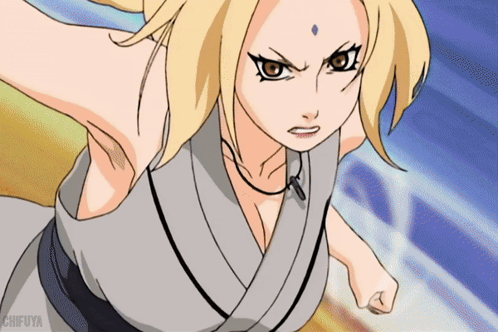

# ▸ Tsunade



<mark style="color:$success;"><strong>»</strong></mark> <strong>IDENTITÉ</strong> <mark style="color:$success;"><strong>«</strong></mark>

➜ <mark style="color:$success;">**Camp**</mark> • <mark style="color:green;">**Shinobi**</mark>

> Objectif : gagner avec les <mark style="color:green;">**Shinobi**</mark>.

➜ <mark style="color:$success;">**Chakra**</mark> • `Nature`

> <mark style="color:orange;">**Doton**</mark> (voir [Natures de chakra](../../particularites/natures-de-chakra.md)).





<mark style="color:$success;"><strong>»</strong></mark> <strong>COMPÉTENCES</strong> <mark style="color:$success;"><strong>«</strong></mark>

➜ <mark style="color:$success;">**Effet**</mark> • `Passif`

> <mark style="color:green;">**Tsunade**</mark> possède <mark style="color:red;">**Force I**</mark>.

➜ <mark style="color:$success;">**Force surhumaine**</mark> • `Passif`

> Tous les **15 coups**, le prochain coup de <mark style="color:green;">**Tsunade**</mark> devient un smash : le joueur subit **1,5**<mark style="color:red;">**❤**</mark> et il est projeté à **15 blocs**, en cassant les blocs sur son passage.

➜ <mark style="color:$success;">**Yens**</mark> • `Passif`

> <mark style="color:green;">**Tsunade**</mark> commence avec **0 ¥** et en gagne :
>
> * **10 ¥** par minerai d'or cassé ;
> * **30 ¥** par pomme d'or mangée ;
> * **5 ¥** par coup d'épée porté à un joueur ;
> * **200 ¥** par assistance ;
> * **400 ¥** par élimination ;
> * **150 ¥** au début de chaque épisode, à partir du deuxième.

➜ <mark style="color:$success;">**Soin médical**</mark> • `Passif`

> Chaque pomme d'or de <mark style="color:green;">**Tsunade**</mark> a **1 chance sur 10** d'être mangée instantanément.





<mark style="color:$success;"><strong>»</strong></mark> <strong>CAPACITÉS</strong> <mark style="color:$success;"><strong>«</strong></mark>

➜ <mark style="color:$success;">**Paris**</mark> • `Clic-Droit`

> `Clic-Droit` : <mark style="color:green;">**Tsunade**</mark> choisit un pari dans le menu, puis le joueur concerné. Si le pari est juste, l'information est confirmée. S'il est faux, elle subit le malus :
>
> * **Ce joueur a un effet** (**400 ¥**) : sinon, <mark style="color:$tint;">**Faiblesse I**</mark> pendant **10 secondes**.
> * **Il a utilisé un pouvoir il y a moins de 10 minutes** (**500 ¥**) : sinon, <mark style="color:purple;">**Lenteur I**</mark> pendant **15 secondes**.
> * **Il a fait au moins une élimination** (**600 ¥**) : sinon, elle perd **1,5**<mark style="color:red;">**❤**</mark>.
> * **Il possède cette nature** (**750 ¥**) : sinon, <mark style="color:violet;">**Cécité**</mark> pendant **4 secondes** et <mark style="color:green;">**Nausée**</mark> pendant **8 secondes**.
> * **Il appartient au camp Shinobi** (**1 200 ¥**) : sinon, elle perd **2,5**<mark style="color:red;">**❤**</mark> et subit <mark style="color:$tint;">**Faiblesse I**</mark> et <mark style="color:purple;">**Lenteur I**</mark> pendant **15 secondes**.
> * **Ces deux joueurs sont du même camp** (**1 000 ¥**) : la réponse ne dit pas lequel. Sinon, elle perd **2**<mark style="color:red;">**❤**</mark> et subit <mark style="color:$tint;">**Faiblesse I**</mark> pendant **15 secondes**.
>
> <mark style="color:red;">⚠ Le pari est payé même s'il est faux.</mark>



***

<figure><figcaption>
Illustration de Tsunade.
</figcaption></figure>

