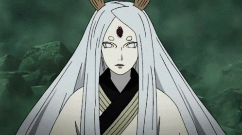

# ▸ Kaguya



<mark style="color:$success;"><strong>»</strong></mark> <strong>IDENTITÉ</strong> <mark style="color:$success;"><strong>«</strong></mark>

➜ <mark style="color:$success;">**Camp**</mark> • <mark style="color:orange;">**Solos**</mark>

> Objectif : gagner **seul**.

➜ <mark style="color:$success;">**Chakra**</mark> • `Nature`

> <mark style="color:red;">**Katon**</mark>, <mark style="color:blue;">**Suiton**</mark>, <mark style="color:yellow;">**Raiton**</mark>, <mark style="color:green;">**Fûton**</mark> et <mark style="color:orange;">**Doton**</mark> (voir [Natures de chakra](../../particularites/natures-de-chakra.md)).





<mark style="color:$success;"><strong>»</strong></mark> <strong>COMPÉTENCES</strong> <mark style="color:$success;"><strong>«</strong></mark>

➜ <mark style="color:$success;">**Effet**</mark> • `Passif`

> <mark style="color:orange;">**Kaguya**</mark> possède <mark style="color:red;">**Force I**</mark>, <mark style="color:blue;">**Résistance I**</mark> et **12**<mark style="color:red;">**❤**</mark> maximum, aussi dans ses dimensions.

➜ <mark style="color:$success;">**Byakugan**</mark> • `Passif`

> <mark style="color:orange;">**Kaguya**</mark> voit les joueurs à moins de **30 blocs** en surbrillance blanche, avec leur vie au-dessus de leur tête. `/ns byakugan` active ou coupe la surbrillance.

➜ <mark style="color:$success;">**Dimension de Glace**</mark> • `Particularités`

> <mark style="color:orange;">**Kaguya**</mark> a <mark style="color:cyan;">**Vitesse I**</mark>. Quand elle marche, le sol devient de la glace sur **3 × 3 blocs**.
>
> Le gel des adversaires monte de **2 %** par seconde et à chacun de ses coups. À **100 %** : immobilisé **1,5 seconde**, puis le gel revient à 0 %.

➜ <mark style="color:$success;">**Dimension de Lave**</mark> • `Particularités`

> Des météorites tombent au hasard ; un cercle orange annonce l'impact : **1,5**<mark style="color:red;">**❤**</mark> et **5 secondes** de feu. <mark style="color:orange;">**Kaguya**</mark> a <mark style="color:cyan;">**Vitesse I**</mark>, et ses coups ont **15 %** de chances d'enflammer.
>
> ➜ <mark style="color:$success;">**Réutiliser l'objet**</mark> • **30 secondes**
>
> > une météorite là où elle vise.

➜ <mark style="color:$success;">**Dimension de Gravité**</mark> • `Particularités`

> Toutes les **10 secondes**, les adversaires sont projetés de **5 blocs** au hasard ; vers le bas, ils ne peuvent plus sauter jusqu'au changement suivant.
>
> <mark style="color:orange;">**Kaguya**</mark> n'est jamais projetée : <mark style="color:cyan;">**Vitesse II**</mark> et <mark style="color:$success;">**Sauts améliorés IV**</mark>. Les autres participants ont <mark style="color:cyan;">**Vitesse I**</mark>.





<mark style="color:$success;"><strong>»</strong></mark> <strong>CAPACITÉS</strong> <mark style="color:$success;"><strong>«</strong></mark>

➜ <mark style="color:$success;">**Yomotsu Hirasaka — Portails Dimensionnels**</mark> • `Clic-Droit` • ⌚ : 3 minutes

> `Clic-Droit` : <mark style="color:orange;">**Kaguya**</mark> est téléportée à **30 blocs** devant elle, par un portail noir.

➜ <mark style="color:$success;">**Amenominaka — Changement de Dimension**</mark> • `Clic-Gauche` • ⌚ : 15 minutes (partagé)

> `Clic-Gauche` : <mark style="color:orange;">**Kaguya**</mark> choisit une dimension.
>
> `Clic-Droit` : <mark style="color:orange;">**Kaguya**</mark> et les joueurs à moins de **30 blocs** sont téléportés dans cette dimension pendant **1 min 30**.
>
> `Sneak + Clic-Droit` : <mark style="color:orange;">**Kaguya**</mark> termine la dimension.
>
> Retour : au même endroit ou aléatoire, réglable avec `/ns dimension`.
>
> <mark style="color:red;">⚠ Dans les dimensions, personne ne monte à plus de </mark><mark style="color:red;">**5 blocs**</mark><mark style="color:red;"> au-dessus du sol.</mark>

➜ <mark style="color:$success;">**Retour de la Déesse — Jûbi**</mark> • `/ns jubi`

> <mark style="color:orange;">**Kaguya**</mark> peut aussi réunir **6 Bijû** différents et faire le rituel elle-même avec `/ns jubi`.
>
> Quand un autre joueur devient Jinchûriki de Jûbi, une flèche le montre à <mark style="color:orange;">**Kaguya**</mark> pendant **2 minutes**.
>
> Si elle le tue elle-même, elle fait `Clic-Droit` **10 secondes** sur son cadavre, sans être touchée, pour absorber Jûbi. Elle garde alors tous ses pouvoirs.
>
> <mark style="color:red;">⚠ Les effets identiques ne se cumulent pas.</mark>
>
> Voir [Jinchûriki des Six Chemins](../../particularites/jubi/jinchuriki-des-six-chemins.md).



***

<figure><figcaption>
Illustration de Kaguya.
</figcaption></figure>

