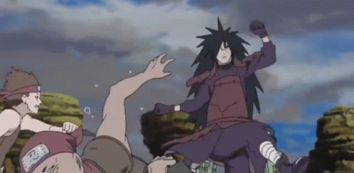

# ▸ Madara



<mark style="color:$success;"><strong>»</strong></mark> <strong>IDENTITÉ</strong> <mark style="color:$success;"><strong>«</strong></mark>

➜ <mark style="color:$success;">**Camp**</mark> • <mark style="color:orange;">**Solos**</mark>

> Objectif : gagner **seul** (pacte 1), ou en <mark style="color:yellow;">**duo**</mark> avec <mark style="color:yellow;">**Obito**</mark> (pacte 2).

➜ <mark style="color:$success;">**Chakra**</mark> • `Nature`

> <mark style="color:red;">**Katon**</mark>, <mark style="color:blue;">**Suiton**</mark>, <mark style="color:yellow;">**Raiton**</mark>, <mark style="color:green;">**Fûton**</mark> et <mark style="color:orange;">**Doton**</mark> (voir [Natures de chakra](../../particularites/natures-de-chakra.md)).





<mark style="color:$success;"><strong>»</strong></mark> <strong>COMPÉTENCES</strong> <mark style="color:$success;"><strong>«</strong></mark>

➜ <mark style="color:$success;">**Choix du pacte**</mark> • `/ns pacte`

> Au début de la partie, <mark style="color:orange;">**Madara**</mark> reçoit seulement un coffre. `Clic-Droit` dessus (ou `/ns pacte`) pour choisir son pacte.
>
> Les boutons **Visualiser** affichent dans le chat sa fiche avec chaque pacte.
>
> ⚠ Le choix est définitif : ses pouvoirs et sa fiche complète arrivent juste après.

➜ <mark style="color:$success;">**Effet**</mark> • `Passif`

> <mark style="color:orange;">**Madara**</mark> possède <mark style="color:red;">**Force I**</mark> et <mark style="color:orange;">**Résistance au feu**</mark> en permanence.

➜ <mark style="color:$success;">**Pacte 1 — Gagner seul**</mark> • `Condition de victoire`

> <mark style="color:orange;">**Madara**</mark> doit éliminer tous les autres joueurs, [<mark style="color:red;">**Obito**</mark>](../akatsuki/obito.md) compris.
>
> * **13**<mark style="color:red;">**❤**</mark>.
> * Il voit la vie des joueurs en pourcentage sous leur pseudo.
> * Il reçoit la **Traque des Bijû**.
> * Son **Gakidō** peut absorber les pouvoirs.

➜ <mark style="color:$success;">**Pacte 2 — Gagner avec Obito**</mark> • `Condition de victoire`

> <mark style="color:orange;">**Madara**</mark> gagne uniquement avec <mark style="color:yellow;">**Obito**</mark>, en <mark style="color:yellow;">**duo**</mark>.
>
> * [<mark style="color:red;">**Obito**</mark>](../akatsuki/obito.md) quitte l'Akatsuki et obtient <mark style="color:red;">**Force I**</mark> et une flèche vers [<mark style="color:green;">**Kakashi**</mark>](../shinobi/kakashi.md).
> * Ils se connaissent, leurs pseudos sont en jaune l'un pour l'autre, et ils ont un chat commun.
> * [<mark style="color:red;">**Nagato**</mark>](../akatsuki/nagato.md) apprend le pacte.
> * Ils réunissent ensemble les **6 Bijû** avec `/ns jubi`.
>
> ⚠ Avec ce pacte, <mark style="color:orange;">**Madara**</mark> garde **10**<mark style="color:red;">**❤**</mark>, sans la vie des joueurs, ni la Traque des Bijû, ni le Gakidō.
>
> Tengai Shinsei ne s'utilise qu'**une fois par partie**, et le Susanoo se recharge en **15 minutes**.

➜ <mark style="color:$success;">**Gakidō — Absorption**</mark> • `Particularités`

> Avec le pacte solo uniquement, chaque pouvoir utilisé contre <mark style="color:orange;">**Madara**</mark> a **15 %** de chances d'être absorbé : il ne lui fait ni dégâts ni effet.

➜ <mark style="color:$success;">**Gunbai**</mark> • `Particularités`

> <mark style="color:orange;">**Madara**</mark> possède une épée en diamant **Tranchant III**, Gunbai. Quand il pare avec, une onde projette à **20 blocs** les joueurs à moins de **5 blocs**, au plus une fois toutes les **3 minutes**.

➜ <mark style="color:$success;">**Résurrection de Jûbi**</mark> • `/ns jubi`

> Avec **6 Bijû** différents en sa possession (actifs ou en objet), `/ns jubi` lance le rituel ; dans le pacte 2, <mark style="color:orange;">**Madara**</mark> et [<mark style="color:red;">**Obito**</mark>](../akatsuki/obito.md) les confient à celui des deux qui le lancera.
>
> Le rituel : le Gedō Mazō sort de terre, les six Bijû tournent autour de plus en plus vite puis sont absorbés, et Jûbi rejoint celui qui a lancé la commande, qui en devient le Jinchûriki.
>
> Voir [Jinchûriki des Six Chemins](../../particularites/jubi/jinchuriki-des-six-chemins.md).





<mark style="color:$success;"><strong>»</strong></mark> <strong>CAPACITÉS</strong> <mark style="color:$success;"><strong>«</strong></mark>

➜ <mark style="color:$success;">**Tengai Shinsei**</mark> • `Clic-Droit` • ⌚ : 20 minutes

> Une immense boule de pierre tombe du ciel pendant **8 secondes**, puis creuse un trou sphérique de **50 blocs** de diamètre.
>
> À l'impact, la vie des autres joueurs à moins de **50 blocs** tombe à **½**<mark style="color:red;">**❤**</mark>, quelle que soit leur vie avant.
>
> ⚠ Avec le **pacte 2**, Tengai Shinsei n'est utilisable qu'**une seule fois par partie**.

➜ <mark style="color:$success;">**Susanoo**</mark> • `Clic-Droit` • ⏳ : 2 minutes • ⌚ : 10 minutes

> Un Susanoo bleu entoure <mark style="color:orange;">**Madara**</mark> pendant **2 minutes** :
>
> * <mark style="color:blue;">**Résistance I**</mark> ;
> * ses coups d'épée ont **25 %** de chances d'enflammer.
>
> ⚠ Avec le **pacte 2**, le Susanoo se recharge en **15 minutes** au lieu de **10 minutes**.

➜ <mark style="color:$success;">**Rinnegan**</mark> • `Clic-Droit` • ⌚ : 5 minutes

> `Clic-Droit` : une onde à 360° détruit les blocs dans un rayon de **30 blocs** et projette les joueurs à **30 blocs**.
>
> `Clic-Gauche` : <mark style="color:orange;">**Madara**</mark> attire vers lui le joueur visé à moins de **30 blocs**.
>
> ➜ <mark style="color:$success;">**Attraction**</mark> • `Clic-Gauche` • ⌚ : 3 minutes

➜ <mark style="color:$success;">**Traque des Bijû**</mark> • `Clic-Droit`

> `Clic-Droit` : <mark style="color:orange;">**Madara**</mark> choisit un Bijû à suivre. Libre : sa position ; possédé : son hôte (pseudo et position) ; pas encore apparu : lieu et moment prévus.
>
> ⚠ Pacte solo seulement.



***

<figure><figcaption>
Illustration de Madara.
</figcaption></figure>

