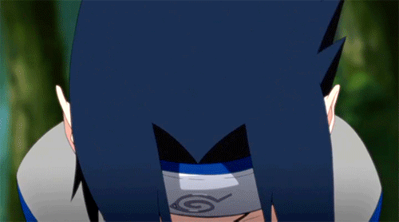

# ▸ Sasuke



<mark style="color:$success;"><strong>»</strong></mark> <strong>IDENTITÉ</strong> <mark style="color:$success;"><strong>«</strong></mark>

➜ <mark style="color:$success;">**Camp**</mark> • <mark style="color:orange;">**Solos**</mark>

> Objectif : gagner **seul**.

➜ <mark style="color:$success;">**Chakra**</mark> • `Nature`

> <mark style="color:red;">**Katon**</mark> et <mark style="color:yellow;">**Raiton**</mark> (voir [Natures de chakra](../../particularites/natures-de-chakra.md)).





<mark style="color:$success;"><strong>»</strong></mark> <strong>COMPÉTENCES</strong> <mark style="color:$success;"><strong>«</strong></mark>

➜ <mark style="color:$success;">**Effet**</mark> • `Passif`

> <mark style="color:orange;">**Sasuke**</mark> possède <mark style="color:red;">**Force I**</mark>, <mark style="color:orange;">**Résistance au feu**</mark> et **12**<mark style="color:red;">**❤**</mark>, et une épée en diamant **Tranchant III**, l'Épée de Kusanagi.

➜ <mark style="color:$success;">**Sharingan**</mark> • `Passif`

> Contre un même joueur, <mark style="color:orange;">**Sasuke**</mark> esquive **5 %** de ses coups après **30 secondes** de combat, puis **10 %** après **1 minute**.





<mark style="color:$success;"><strong>»</strong></mark> <strong>CAPACITÉS</strong> <mark style="color:$success;"><strong>«</strong></mark>

➜ <mark style="color:$success;">**Amaterasu**</mark> • `Clic-Droit` • ⌚ : 5 minutes

> <mark style="color:orange;">**Sasuke**</mark> enflamme le joueur visé à moins de **30 blocs** pendant **7 secondes**. Ce feu ne peut pas être éteint.
>
> **Usure des yeux**
>
> * À la **2ᵉ** utilisation : <mark style="color:violet;">**Cécité**</mark> pendant **1 seconde**.
> * À la **3ᵉ** utilisation : <mark style="color:violet;">**Cécité**</mark> pendant **3 secondes**.
> * Ensuite : <mark style="color:violet;">**Cécité**</mark> pendant **5 secondes** à chaque fois.

➜ <mark style="color:$success;">**Les Yeux d'Itachi**</mark> • `Clic-Droit`

> <mark style="color:orange;">**Sasuke**</mark> connaît [<mark style="color:red;">**Itachi**</mark>](../akatsuki/itachi.md) dès le début. À sa mort, une flèche montre son cadavre : `Clic-Droit` dessus pour prendre ses yeux.
>
> <mark style="color:orange;">**Sasuke**</mark> n'a alors plus de cécité avec Amaterasu, et ses coups d'épée ont **15 %** de chances d'enflammer.
>
> ➜ S'il a tué [<mark style="color:red;">**Itachi**</mark>](../akatsuki/itachi.md) lui-même, le cooldown de son Susanoo passe à **10 minutes**.

➜ <mark style="color:$success;">**Susanoo**</mark> • `Clic-Droit` • ⏳ : 2 minutes • ⌚ : 15 minutes

> Un Susanoo violet entoure <mark style="color:orange;">**Sasuke**</mark> pendant **2 minutes** : il obtient <mark style="color:blue;">**Résistance I**</mark>. Avec les yeux d'[<mark style="color:red;">**Itachi**</mark>](../akatsuki/itachi.md), ses coups ont **20 %** de chances d'enflammer pendant la transformation.
>
> ➜ <mark style="color:$success;">**Flèche d'Indra**</mark> • `Clic-Droit` • une fois par Susanoo
>
> > une flèche géante bleue se forme au-dessus de <mark style="color:orange;">**Sasuke**</mark> pendant **5 secondes**, et la foudre le frappe chaque seconde, puis elle part devant lui.
> >
> > Les joueurs touchés perdent **2**<mark style="color:red;">**❤**</mark> de vie maximale pendant **10 minutes**, sont projetés à **30 blocs** en cassant les blocs, et subissent <mark style="color:green;">**Nausée**</mark> pendant **10 secondes** et <mark style="color:violet;">**Cécité II**</mark> pendant **30 secondes**.

➜ <mark style="color:$success;">**Kirin**</mark> • `Clic-Droit` • ⏳ : 2 minutes • ⌚ : 10 minutes

> De gros nuages orange se forment au-dessus d'un rayon de **30 blocs** autour de <mark style="color:orange;">**Sasuke**</mark> pendant **2 minutes**.
>
> Toutes les **3 secondes**, un éclair tombe au hasard dans la zone, avec **25 %** de chances de viser un joueur : il subit **1,5**<mark style="color:red;">**❤**</mark> et il est immobilisé **0,2 seconde**.

➜ <mark style="color:$success;">**Amenotejikara**</mark> • `Clic-Droit` • ⌚ : 3 minutes

> <mark style="color:orange;">**Sasuke**</mark> échange sa place avec le joueur visé à moins de **30 blocs**.



***

<figure><figcaption>
Illustration de Sasuke.
</figcaption></figure>

